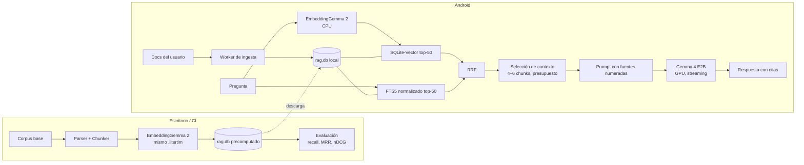
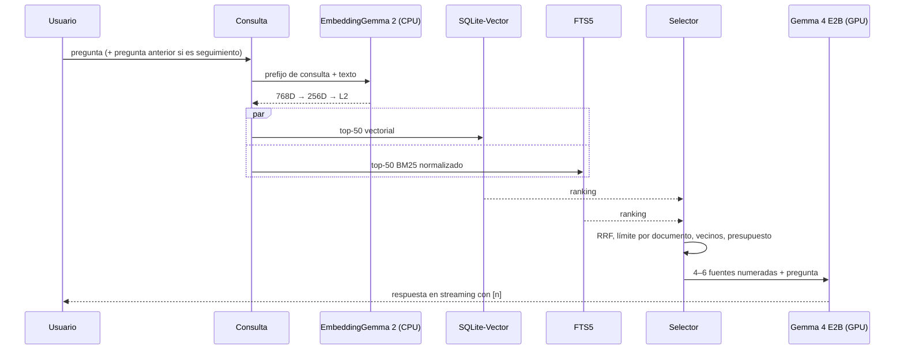

# RAG 100 % local en Android con Gemma 4, EmbeddingGemma 2 y SQLite-Vector

**Versión 2 · Prueba de concepto · 25 de octubre de 2026**

## Qué cambia respecto a la versión 1

La versión 1 acertaba en la arquitectura: SQLite como fuente de verdad, F32 como vector maestro, INT8 como índice derivado, búsqueda híbrida con RRF y no introducir HNSW sin medir. Esa base se conserva. Lo que faltaba era todo lo que rodea al motor vectorial, que es donde se decide si el POC funciona o no.

| Área | v1 | v2 |
|---|---|---|
| Origen del índice | Solo ingesta en el móvil | **Índice precomputado offline** con el mismo `.litertlm` + ingesta en móvil para documentos del usuario |
| Distribución de modelos | `assets/models/` (inviable con ~3 GB) | Descarga verificada a `noBackupFilesDir`; Play Asset Delivery para producción |
| Parsing | No tratado | PdfBox-Android, ML Kit OCR para escaneados, Jsoup para HTML |
| Chunking | No tratado | Por estructura, 300–400 tokens, solape ~15 %, cabecera contextual en el texto embebido |
| FTS en español | `unicode61` + OR de todos los tokens | Columnas normalizadas con stopwords y stemmer ligero español; BM25 ponderado |
| Contexto al LLM | 8–12 chunks | **4–6 chunks** con presupuesto de tokens, límite por documento y expansión de vecinos |
| Prompt | No definido | Plantilla con fuentes numeradas, citas `[n]` y negativa explícita |
| Memoria | Ambos engines en GPU | Embedding de consulta en CPU, LLM en GPU, liberar engines según fase |
| Ingesta | Bucle simple | Worker en primer plano, reanudable, por lotes transaccionales |
| Iteración | Todo en el móvil | **Ajuste de recuperación en escritorio** con los mismos artefactos y métricas |
| Corrección de código | `vector_init` tragándose errores, preload perdido tras muerte del proceso | Inicialización por conexión, preload en segundo plano, flag `quant_dirty` |

## Resumen ejecutivo

El stack recomendado para el POC es:

> **Gemma 4 E2B + EmbeddingGemma 2 (256D, L2) sobre LiteRT-LM 0.18.1 · SQLite bundled + SQLite-Vector + FTS5 normalizado para español · RRF · 4–6 chunks con citas · índice principal construido offline con el mismo modelo de embeddings.**

La mejora de mayor impacto respecto a la v1 no está en el motor vectorial sino en **dónde se construye el índice**. LiteRT-LM tiene API Python con el mismo `EmbeddingEngine` que en Kotlin, así que el corpus base se puede embeber en un PC con el mismo fichero `.litertlm`, los mismos prefijos y la misma truncación, y distribuir el `.db` ya montado. Eso elimina la parte más lenta y frágil del POC (embeber decenas de miles de chunks en el teléfono) y permite **iterar la calidad de recuperación en escritorio en minutos**, no en horas de ingesta en el dispositivo.

La segunda mejora es reconocer que **la latencia percibida la domina el prefill del LLM**, no la búsqueda vectorial. Pasar de 10 a 5 chunks ahorra más tiempo que cualquier optimización de SQLite-Vector, y con una buena selección de contexto no empeora la calidad.



### Configuración base

| Pieza | Elección POC |
|---|---|
| LLM | Gemma 4 E2B instruction-tuned |
| Runtime | LiteRT-LM 0.18.1 (Kotlin en Android, Python offline) |
| Embeddings | EmbeddingGemma 2, `.litertlm` de `litert-community` |
| Dimensión | 256D, normalización L2 tras truncar |
| Backend embedding consulta | CPU (medir GPU como alternativa) |
| Backend LLM | GPU |
| Vector maestro | Float32 little-endian en columna `BLOB` |
| Motor vectorial | SQLite-Vector, coseno, `normalized=1` |
| Aceleración | INT8 + preload solo si p95 de búsqueda > 20 ms |
| Léxico | FTS5 sobre columnas normalizadas (stopwords + stemmer ligero) |
| Fusión | RRF, k = 60 |
| Candidatos | 50 vector + 50 FTS |
| Contexto final | 4–6 chunks, ~2.000–2.500 tokens, máx. 3 por documento |
| SQLite | `androidx.sqlite:sqlite-bundled:2.7.1` |
| ABI | arm64-v8a (añadir x86_64 solo para emulador) |
| Dispositivos de prueba | ARM64, ≥ 8 GB RAM |

## Decisión previa: de dónde sale el corpus

Esta pregunta cambia el diseño más que cualquier elección de motor, así que va primero.

| Caso | Pipeline recomendado |
|---|---|
| Corpus fijo o controlado por vosotros (manuales, normativa, documentación) | **Índice offline.** Se construye en PC/CI y se descarga como un `.db`. El móvil solo embebe consultas. |
| Documentos que aporta el usuario | Ingesta en el dispositivo con worker reanudable. |
| Mixto | Índice offline como base + ingesta en el móvil para lo del usuario, **en la misma tabla** y con el mismo espacio vectorial. |

Para el POC recomiendo empezar con el índice offline aunque el producto final vaya a ser de documentos de usuario. Separa dos problemas (calidad de RAG y viabilidad de ingesta en el móvil) que, mezclados, son muy difíciles de depurar.

### Condición para mezclar vectores offline y del dispositivo

Los vectores son compatibles **solo si** coinciden el fichero `.litertlm` exacto, el prefijo de tarea, la cabecera contextual, la truncación a 256D y la normalización. Aun así, CPU, GPU y los distintos delegados pueden dar pequeñas diferencias numéricas. Por eso el POC incluye un **test de compatibilidad de embeddings**: un conjunto de 50 textos de referencia embebidos offline y en el móvil, con criterio de aceptación coseno ≥ 0,99 para cada par. Si falla, se fija el mismo backend en ambos lados o se re-embebe en el dispositivo.

## Distribución de modelos

Gemma 4 E2B en formato LiteRT-LM ocupa del orden de 2,6 GB y EmbeddingGemma 2 varios cientos de MB, según variante. No pueden ir en `assets/`.

| Fase | Estrategia |
|---|---|
| Desarrollo | `adb push` a un directorio de la app, o descarga desde vuestro servidor |
| POC con usuarios de prueba | Descarga en el primer arranque a `noBackupFilesDir/models/` con WorkManager, reanudación por `Range`, comprobación de espacio libre con `StatFs` y verificación SHA-256 antes de usar |
| Producción | Play Asset Delivery (asset packs *fast-follow* u *on-demand*); revisar los límites de tamaño vigentes |

Reglas: no cargar nunca un modelo cuyo hash no coincida; guardar en `rag_meta` el hash del `.litertlm` de embeddings con el que se construyó el índice, y negarse a buscar si el modelo instalado es otro.

**Variante de EmbeddingGemma 2.** En `litert-community` hay al menos la variante completa de 740M y una variante texto+visión de 440M cuantizada int4/int8 (≈388 MB). Si el corpus es solo texto, comprobar si existe un empaquetado solo de texto; si no, la variante de 440M es la opción razonable para el POC. Usar `ModelInfo` / `litert-lm describe` para leer metadatos y la longitud máxima de entrada del fichero concreto.

## Motor vectorial

Se mantiene la decisión de la v1: **SQLite-Vector**, con embeddings como `BLOB` en una tabla normal, scan exacto SIMD y cuantización INT8 opcional. El ranking para este caso:

**SQLite-Vector > sqlite-vec > USearch > SQLite Vec1 > HNSWlib > FAISS > Qdrant Edge.**

### Espacio

| Vectores | F32 256D | INT8 256D | F32 + INT8 |
|---:|---:|---:|---:|
| 10.000 | 10,2 MB | 2,6 MB | 12,8 MB |
| 50.000 | 51,2 MB | 12,8 MB | 64,0 MB |
| 100.000 | 102,4 MB | 25,6 MB | 128,0 MB |

Solo datos vectoriales; hay que sumar texto, columnas normalizadas, FTS e índices. Como orden de magnitud, el `.db` total suele ser 2–4 veces el tamaño de los vectores F32.

### Latencia (presupuesto, no medición)

Extrapolado del benchmark del fabricante (1M × 768D en Apple M5 Pro: 484 ms F32, 38 ms INT8 preloaded) escalando por N × D y con margen para SoC móvil:

| 256D | 10k | 50k | 100k |
|---|---:|---:|---:|
| F32 exacto | 2–6 ms | 10–25 ms | 25–50 ms |
| INT8 preloaded | 0,5–1,5 ms | 1,5–4 ms | 3–8 ms |

Comparado con un prefill de varios miles de tokens en el LLM, estas cifras son ruido. Criterio:

| Situación | Acción |
|---|---|
| p95 búsqueda vectorial ≤ 20 ms | F32 exacto, sin cuantizar |
| p95 > 20 ms | INT8 + preload |
| INT8 pierde calidad | INT8 top-100 → reranking F32 |
| > 300k vectores o p95 < 5 ms obligatorio | Evaluar USearch, con SQLite como verdad |

## Embeddings con EmbeddingGemma 2

### Prefijos

La documentación de LiteRT-LM define prefijos asimétricos y pide recortar espacios antes de añadirlos:

| Uso | Prefijo |
|---|---|
| Indexar documentos | `task: search result \| text: ` |
| Consulta | `task: search query \| text: ` |

Lo importante es la **consistencia**: el mismo prefijo, con el mismo espacio tras `text:`, offline y en el móvil. Se fija como constante compartida y se guarda en `rag_meta` (`embedding_doc_prefix`, `embedding_query_prefix`).

### Cabecera contextual

Un chunk aislado ("El plazo es de 30 días") pierde su contexto. Se embebe con una cabecera breve y se almacena sin ella:

```text
task: search result | text: Manual de garantías › Devoluciones › Plazos
El plazo para solicitar la devolución es de 30 días naturales...
```

La cabecera es `título del documento › ruta de encabezados`. Mejora la recuperación de forma sistemática y no cuesta nada en tiempo de consulta. El texto almacenado en `content` (el que va al LLM) no la lleva; el LLM recibe la ruta por separado en el bloque de fuente.

### Truncación y normalización

EmbeddingGemma 2 es Matryoshka (768 → 512/256/128). Se toman los primeros 256 componentes y **se vuelve a normalizar L2 después de truncar**. Si la versión de LiteRT-LM que uséis expone la truncación en la configuración, se puede usar, pero la normalización final se hace igualmente en código propio para que offline y móvil sean idénticos.

256D es el punto de partida, no un dogma. La evaluación offline compara 128/256/512 y se elige la menor dimensión que no pierda más de un 1 % de nDCG@10 frente a 768.

### API: una llamada, un embedding

En la API Kotlin, `computeEmbedding(listOf(...))` recibe una lista de **partes de una misma entrada** (texto, imagen, audio) y devuelve un único embedding; no es un batch. El rendimiento de ingesta sale de llamadas en serie sobre un engine caliente, con las escrituras agrupadas en transacciones. No lanzar varias inferencias en paralelo.

### Backend

| Uso | Backend |
|---|---|
| Consulta (un texto corto) | **CPU**: deja la GPU libre para el LLM y evita contención |
| Ingesta masiva en el móvil | GPU si el benchmark lo justifica; liberar el engine al terminar |
| Offline | El que dé coseno ≥ 0,99 contra el móvil en el test de compatibilidad |

## Parsing y chunking

### Extracción

| Formato | Herramienta en Android | Notas |
|---|---|---|
| PDF con texto | PdfBox-Android | `PdfRenderer` solo genera bitmaps, no extrae texto |
| PDF escaneado | Renderizar página con `PdfRenderer` + ML Kit Text Recognition (on-device) | Detectar con "página sin texto extraíble" |
| HTML | Jsoup | Conservar `h1–h4` como ruta de encabezados |
| Markdown / TXT | Parser propio | Encabezados `#` como ruta |
| DOCX | Convertir offline en el POC | Apache POI en Android pesa mucho |

Para el índice offline se puede usar lo mejor disponible en escritorio (por ejemplo, un extractor de PDF con detección de layout y tablas). La calidad del texto extraído limita la calidad de todo lo demás.

### Estrategia

| Parámetro | Valor inicial |
|---|---|
| Unidad | Párrafo; nunca cortar a mitad de frase |
| Tamaño objetivo | 300–400 tokens (≈1.200–1.600 caracteres en español) |
| Máximo duro | Por debajo de la longitud máxima de entrada del modelo, contando prefijo y cabecera |
| Solape | Último párrafo del chunk anterior, ≈15 % |
| Frontera | Un cambio de sección (encabezado) siempre abre chunk nuevo |
| Tablas | Una tabla pequeña es un chunk; si es grande, por filas repitiendo la cabecera |
| Metadatos | Documento, ruta de encabezados, página, `ordinal` consecutivo |

El `ordinal` consecutivo es lo que permite la **expansión de vecinos** en recuperación (añadir el chunk anterior o siguiente al mejor resultado).

```kotlin
data class RawBlock(val headingPath: List<String>, val text: String, val page: Int?)
data class Chunk(val ordinal: Int, val headingPath: String, val content: String, val page: Int?)

class Chunker(
    private val targetChars: Int = 1_400,
    private val maxChars: Int = 2_000
) {
    fun chunk(blocks: List<RawBlock>): List<Chunk> {
        val out = mutableListOf<Chunk>()
        var buf = StringBuilder()
        var path = ""
        var page: Int? = null
        var lastParagraph = ""

        fun flush(carry: Boolean) {
            val text = buf.toString().trim()
            if (text.isNotEmpty()) out += Chunk(out.size, path, text, page)
            buf = StringBuilder()
            if (carry && lastParagraph.length < targetChars / 3) buf.append(lastParagraph).append("\n\n")
        }

        for (b in blocks) {
            val bPath = b.headingPath.joinToString(" › ")
            if (bPath != path) { flush(carry = false); path = bPath; page = b.page }
            for (p in splitParagraphs(b.text, maxChars)) {
                if (buf.length + p.length > targetChars && buf.isNotEmpty()) flush(carry = true)
                if (buf.isEmpty()) page = b.page
                buf.append(p).append("\n\n")
                lastParagraph = p
            }
        }
        flush(carry = false)
        return out
    }

    private fun splitParagraphs(text: String, max: Int): List<String> =
        text.split(Regex("\\n\\s*\\n")).map { it.trim() }.filter { it.isNotEmpty() }
            .flatMap { p -> if (p.length <= max) listOf(p) else splitBySentence(p, max) }

    private fun splitBySentence(p: String, max: Int): List<String> {
        val parts = mutableListOf<String>()
        val cur = StringBuilder()
        for (s in p.split(Regex("(?<=[.!?;:])\\s+"))) {
            if (cur.length + s.length > max && cur.isNotEmpty()) { parts += cur.toString(); cur.clear() }
            cur.append(s).append(' ')
        }
        if (cur.isNotEmpty()) parts += cur.toString().trim()
        return parts
    }
}
```

## Búsqueda léxica en español

`unicode61` no hace stemming en español y la v1 unía con `OR` todos los tokens de la consulta, incluidos "de", "la" o "que". Resultado: muchos candidatos ruidosos y fallos entre singular y plural ("cliente" frente a "clientes").

Solución: columnas normalizadas (`title_norm`, `body_norm`) calculadas en código con **el mismo normalizador** en indexación y consulta. FTS5 indexa esas columnas; el LLM sigue recibiendo `content` original.

Normalización: minúsculas, quitar tildes, eliminar stopwords y aplicar un stemmer ligero (plural y género, al estilo del *Spanish light stemmer* de Lucene). Los tokens con dígitos (códigos, referencias, números de pieza) no se tocan.

```kotlin
object SpanishText {
    private val STOP = setOf(
        "a","al","algo","ante","asi","como","con","contra","cual","cuales","cuando","de","del",
        "desde","donde","durante","e","el","ella","ellas","ellos","en","entre","era","es","esa",
        "esas","ese","eso","esos","esta","estas","este","esto","estos","fue","ha","han","hay",
        "la","las","le","les","lo","los","mas","me","mi","muy","ni","no","nos","o","os","para",
        "pero","por","que","quien","se","sea","ser","si","sin","sobre","su","sus","tambien",
        "te","tiene","u","un","una","uno","unos","unas","y","ya","yo","cuanto","cuanta"
    )
    private val TOKEN = Regex("[\\p{L}\\p{N}]+(?:[-_./][\\p{L}\\p{N}]+)*")
    private val MARKS = Regex("\\p{Mn}+")

    fun tokens(text: String): List<String> {
        val plain = java.text.Normalizer
            .normalize(text.lowercase(), java.text.Normalizer.Form.NFD)
            .replace(MARKS, "")
        return TOKEN.findAll(plain).map { it.value }
            .filter { it !in STOP && it.length > 1 }
            .map(::lightStem)
            .toList()
    }

    fun normalize(text: String): String = tokens(text).joinToString(" ")

    /** Equivalente simplificado del SpanishLightStemmer de Lucene. */
    fun lightStem(t: String): String {
        if (t.length < 5 || t.any { it.isDigit() }) return t
        val n = t.length
        return when (t[n - 1]) {
            'o', 'a', 'e' -> t.substring(0, n - 1)
            's' -> when {
                t.endsWith("eses") -> t.substring(0, n - 2)
                t[n - 2] == 'e' && t[n - 3] == 'c' -> t.substring(0, n - 3) + "z"
                t[n - 2] in "oae" -> t.substring(0, n - 2)
                else -> t
            }
            else -> t
        }
    }

    /** Consulta FTS5: tokens normalizados, entrecomillados, unidos con OR. */
    fun ftsQuery(userQuery: String, maxTerms: Int = 16): String =
        tokens(userQuery).distinct().take(maxTerms)
            .joinToString(" OR ") { "\"" + it.replace("\"", "\"\"") + "\"" }
}
```

Ejemplos: `clientes → client`, `cliente → client`, `motores → motor`, `luces → luz`, `R-1234 → r-1234` (intacto).

El normalizador existe dos veces (Kotlin y Python offline). Se mantiene un fichero `normalizer_golden.json` con unos cientos de pares entrada/salida y ambos lados lo pasan como test. Si no coinciden, el FTS del índice offline no casa con las consultas del móvil.

Con BM25 ponderado se da más peso al título y la ruta de encabezados:

```sql
ORDER BY bm25(chunks_fts, 3.0, 1.0)
```

Si la evaluación muestra que se pierden coincidencias parciales en códigos o nombres compuestos, se añade una segunda tabla FTS5 con `tokenize='trigram'` solo sobre `content`, como tercera lista en el RRF.

## Esquema SQLite

Un único `schema.sql`, compartido por el script offline (Python) y la app (se carga desde `assets/`). Cambios frente a la v1: columnas normalizadas para FTS, ruta de encabezados, estado de ingesta por documento y metadatos del espacio vectorial.

```sql
PRAGMA foreign_keys = ON;

CREATE TABLE IF NOT EXISTS rag_meta (
    key   TEXT PRIMARY KEY,
    value TEXT NOT NULL
);

CREATE TABLE IF NOT EXISTS documents (
    id              INTEGER PRIMARY KEY,
    source          TEXT NOT NULL CHECK (source IN ('base','user')),
    uri             TEXT,
    display_name    TEXT NOT NULL,
    mime_type       TEXT,
    content_hash    TEXT NOT NULL UNIQUE,
    status          TEXT NOT NULL DEFAULT 'pending'
                    CHECK (status IN ('pending','parsed','embedding','done','error')),
    chunk_count     INTEGER,
    error           TEXT,
    created_at_ms   INTEGER NOT NULL,
    updated_at_ms   INTEGER NOT NULL
);

CREATE TABLE IF NOT EXISTS chunks (
    id              INTEGER PRIMARY KEY,
    document_id     INTEGER NOT NULL REFERENCES documents(id) ON DELETE CASCADE,
    ordinal         INTEGER NOT NULL,
    heading_path    TEXT,
    page            INTEGER,
    content         TEXT NOT NULL,
    title_norm      TEXT NOT NULL,
    body_norm       TEXT NOT NULL,
    token_estimate  INTEGER NOT NULL,
    embedding       BLOB NOT NULL,
    UNIQUE (document_id, ordinal)
);

CREATE INDEX IF NOT EXISTS idx_chunks_doc ON chunks(document_id, ordinal);

CREATE VIRTUAL TABLE IF NOT EXISTS chunks_fts USING fts5(
    title_norm,
    body_norm,
    content = 'chunks',
    content_rowid = 'id',
    tokenize = 'unicode61 remove_diacritics 2'
);

CREATE TRIGGER IF NOT EXISTS chunks_ai AFTER INSERT ON chunks BEGIN
    INSERT INTO chunks_fts(rowid, title_norm, body_norm)
    VALUES (new.id, new.title_norm, new.body_norm);
END;

CREATE TRIGGER IF NOT EXISTS chunks_ad AFTER DELETE ON chunks BEGIN
    INSERT INTO chunks_fts(chunks_fts, rowid, title_norm, body_norm)
    VALUES ('delete', old.id, old.title_norm, old.body_norm);
END;

CREATE TRIGGER IF NOT EXISTS chunks_au AFTER UPDATE OF title_norm, body_norm ON chunks BEGIN
    INSERT INTO chunks_fts(chunks_fts, rowid, title_norm, body_norm)
    VALUES ('delete', old.id, old.title_norm, old.body_norm);
    INSERT INTO chunks_fts(rowid, title_norm, body_norm)
    VALUES (new.id, new.title_norm, new.body_norm);
END;
```

`title_norm` es la normalización de `nombre del documento + ruta de encabezados`; `body_norm`, la de `content`.

Claves obligatorias en `rag_meta`:

| Clave | Ejemplo |
|---|---|
| `schema_version` | `2` |
| `embedding_model_sha256` | hash del `.litertlm` usado |
| `embedding_dims` | `256` |
| `embedding_doc_prefix` | `task: search result \| text: ` |
| `embedding_query_prefix` | `task: search query \| text: ` |
| `normalizer_version` | `1` |
| `quant_dirty` | `0` / `1` |

Al abrir, la app compara estas claves con su propia configuración. Si el modelo, la dimensión, los prefijos o la versión del normalizador no coinciden, no busca: re-embebe o descarga un índice nuevo.

## Capa de datos en Kotlin

Cambios frente a la v1:

- `vector_init` se trata como configuración de conexión: se ejecuta en cada apertura y no se silencian errores genéricos. Hay que confirmar en la documentación de la versión exacta de SQLite-Vector si la configuración persiste en el fichero; con este patrón funciona en ambos casos siempre que la llamada sea idempotente.
- El *preload* INT8 vive en memoria del proceso. Tras una muerte del proceso hay que repetirlo, en segundo plano y solo si se usa INT8 y `quant_dirty = 0`.
- La versión del artefacto Maven de SQLite-Vector (`ai.sqlite:vector`) y el nombre del `.so` se toman de Maven Central y del AAR concreto, no se suponen.

```kotlin
class RagDatabase(
    private val databasePath: String,
    private val vectorExtensionPath: String,
    private val schemaSql: String,
    private val dims: Int = 256
) : Closeable {

    private val driver = BundledSQLiteDriver().apply { addExtension(vectorExtensionPath) }
    private val db: SQLiteConnection = driver.open(databasePath)
    @Volatile var int8Ready = false
        private set

    init {
        exec("PRAGMA journal_mode = WAL")
        exec("PRAGMA synchronous = NORMAL")
        exec("PRAGMA temp_store = MEMORY")
        exec("PRAGMA foreign_keys = ON")
        schemaSql.split(Regex(";\\s*\\n(?=CREATE|PRAGMA)"))
            .map { it.trim().removeSuffix(";") }
            .filter { it.isNotEmpty() }
            .forEach { exec(it) }
        exec(
            "SELECT vector_init('chunks','embedding'," +
                "'type=FLOAT32,dimension=$dims,distance=COSINE,normalized=1')"
        )
    }

    fun meta(key: String): String? =
        db.prepare("SELECT value FROM rag_meta WHERE key = ?").use { s ->
            s.bindText(1, key); if (s.step()) s.getText(0) else null
        }

    fun setMeta(key: String, value: String) =
        db.prepare("INSERT OR REPLACE INTO rag_meta(key, value) VALUES (?, ?)").use { s ->
            s.bindText(1, key); s.bindText(2, value); s.step()
        }

    /** Inserta un lote en una transacción. Idempotente gracias a UNIQUE(document_id, ordinal). */
    fun insertChunks(batch: List<ChunkRow>) {
        if (batch.isEmpty()) return
        transaction {
            db.prepare(
                """
                INSERT OR IGNORE INTO chunks(document_id, ordinal, heading_path, page, content,
                    title_norm, body_norm, token_estimate, embedding)
                VALUES (?, ?, ?, ?, ?, ?, ?, ?, vector_as_f32(?))
                """.trimIndent()
            ).use { s ->
                for (c in batch) {
                    require(c.embedding.size == dims)
                    s.bindLong(1, c.documentId)
                    s.bindLong(2, c.ordinal.toLong())
                    c.headingPath?.let { s.bindText(3, it) } ?: s.bindNull(3)
                    c.page?.let { s.bindLong(4, it.toLong()) } ?: s.bindNull(4)
                    s.bindText(5, c.content)
                    s.bindText(6, c.titleNorm)
                    s.bindText(7, c.bodyNorm)
                    s.bindLong(8, c.tokenEstimate.toLong())
                    s.bindBlob(9, c.embedding.toLeBlob())
                    s.step(); s.reset()
                }
            }
            setMeta("quant_dirty", "1")
        }
        int8Ready = false
    }

    fun vectorSearch(query: FloatArray, k: Int = 50): List<Long> {
        val fn = if (int8Ready) "vector_quantize_scan" else "vector_full_scan"
        return db.prepare("SELECT rowid FROM $fn('chunks','embedding', ?, ?)").use { s ->
            s.bindBlob(1, query.toLeBlob()); s.bindLong(2, k.toLong())
            buildList { while (s.step()) add(s.getLong(0)) }
        }
    }

    fun ftsSearch(ftsQuery: String, k: Int = 50): List<Long> {
        if (ftsQuery.isBlank()) return emptyList()
        return db.prepare(
            "SELECT rowid FROM chunks_fts WHERE chunks_fts MATCH ? " +
                "ORDER BY bm25(chunks_fts, 3.0, 1.0) LIMIT ?"
        ).use { s ->
            s.bindText(1, ftsQuery); s.bindLong(2, k.toLong())
            buildList { while (s.step()) add(s.getLong(0)) }
        }
    }

    fun loadChunks(ids: Collection<Long>): Map<Long, ChunkView> {
        if (ids.isEmpty()) return emptyMap()
        val placeholders = ids.joinToString(",") { "?" }
        return db.prepare(
            """
            SELECT c.id, c.document_id, c.ordinal, c.heading_path, c.page, c.content,
                   c.token_estimate, d.display_name
            FROM chunks c JOIN documents d ON d.id = c.document_id
            WHERE c.id IN ($placeholders)
            """.trimIndent()
        ).use { s ->
            ids.forEachIndexed { i, id -> s.bindLong(i + 1, id) }
            buildMap {
                while (s.step()) {
                    val v = ChunkView(
                        id = s.getLong(0), documentId = s.getLong(1), ordinal = s.getLong(2).toInt(),
                        headingPath = if (s.isNull(3)) null else s.getText(3),
                        page = if (s.isNull(4)) null else s.getLong(4).toInt(),
                        content = s.getText(5), tokenEstimate = s.getLong(6).toInt(),
                        documentName = s.getText(7)
                    )
                    put(v.id, v)
                }
            }
        }
    }

    fun neighbor(documentId: Long, ordinal: Int): ChunkView? =
        db.prepare("SELECT id FROM chunks WHERE document_id = ? AND ordinal = ?").use { s ->
            s.bindLong(1, documentId); s.bindLong(2, ordinal.toLong())
            if (s.step()) s.getLong(0) else null
        }?.let { loadChunks(listOf(it))[it] }

    /** Llamar al terminar una importación o con la app en reposo. */
    fun rebuildInt8() {
        exec("SELECT vector_quantize('chunks','embedding','qtype=INT8')")
        exec("SELECT vector_quantize_preload('chunks','embedding')")
        setMeta("quant_dirty", "0")
        int8Ready = true
    }

    /** Tras arrancar el proceso, en segundo plano. */
    fun preloadInt8IfClean() {
        if (meta("quant_dirty") == "0") {
            exec("SELECT vector_quantize_preload('chunks','embedding')")
            int8Ready = true
        }
    }

    private inline fun transaction(block: () -> Unit) {
        exec("BEGIN IMMEDIATE")
        try { block(); exec("COMMIT") } catch (t: Throwable) { exec("ROLLBACK"); throw t }
    }

    private fun exec(sql: String) = db.prepare(sql).use { s -> while (s.step()) Unit }

    override fun close() = db.close()
}

data class ChunkRow(
    val documentId: Long, val ordinal: Int, val headingPath: String?, val page: Int?,
    val content: String, val titleNorm: String, val bodyNorm: String,
    val tokenEstimate: Int, val embedding: FloatArray
)

data class ChunkView(
    val id: Long, val documentId: Long, val ordinal: Int, val headingPath: String?,
    val page: Int?, val content: String, val tokenEstimate: Int, val documentName: String
)

fun FloatArray.toLeBlob(): ByteArray =
    java.nio.ByteBuffer.allocate(size * 4).order(java.nio.ByteOrder.LITTLE_ENDIAN)
        .also { b -> forEach(b::putFloat) }.array()
```

Una sola conexión de escritura serializada. Para lecturas concurrentes con WAL se puede abrir una segunda conexión de solo lectura, ejecutando también `vector_init` en ella.

Cuando el `quant_dirty` está a 1, la búsqueda usa F32 exacto automáticamente. Si el criterio de latencia nunca obliga a INT8, todo este bloque se queda sin usar y no pasa nada.

## Recuperación y selección de contexto

### Flujo



### Preguntas de seguimiento

"¿Y para empresas?" no recupera nada útil por sí sola. Reescribirla con el LLM cuesta una inferencia extra (segundos). Para el POC basta una regla sin LLM: si la pregunta es corta (< 8 tokens normalizados) o empieza por conectores ("y", "pero", "entonces", "¿y si…"), la consulta de búsqueda es `pregunta anterior + pregunta actual`. Medirlo en la evaluación con un subconjunto de pares de seguimiento.

### Selección de contexto

La v1 mandaba 8–12 chunks. Con 350 tokens por chunk son 3.000–4.000 tokens de prefill solo en contexto, lo que en un móvil se traduce en segundos de espera antes del primer token. La selección v2:

1. RRF sobre las dos listas (k = 60).
2. Recorrer en orden de RRF y aceptar un chunk si su documento no tiene ya 3 seleccionados.
3. Para los 2 mejores, añadir el vecino siguiente (`ordinal + 1`) si cabe en el presupuesto; si el vecino ya estaba seleccionado, se fusionan en un único bloque.
4. Parar al llegar a 6 bloques o a ~2.200 tokens.
5. Ordenar los bloques finales por documento y `ordinal`, no por puntuación: el LLM lee mejor un texto en orden.

```kotlin
class HybridRetriever(
    private val db: RagDatabase,
    private val embedder: Embedder,
    private val rrfK: Int = 60,
    private val candidates: Int = 50
) {
    fun retrieve(question: String, previousQuestion: String?): List<ContextBlock> {
        val searchText = if (previousQuestion != null && isFollowUp(question))
            "$previousQuestion $question" else question

        val vec = db.vectorSearch(embedder.embedQuery(searchText), candidates)
        val lex = db.ftsSearch(SpanishText.ftsQuery(searchText), candidates)

        val score = HashMap<Long, Double>()
        vec.forEachIndexed { i, id -> score.merge(id, 1.0 / (rrfK + i + 1), Double::plus) }
        lex.forEachIndexed { i, id -> score.merge(id, 1.0 / (rrfK + i + 1), Double::plus) }

        val ranked = score.entries.sortedByDescending { it.value }.map { it.key }.take(30)
        val views = db.loadChunks(ranked)
        return ContextSelector().select(ranked.mapNotNull { views[it] }, db)
    }

    private fun isFollowUp(q: String): Boolean {
        val t = q.trim().lowercase()
        return SpanishText.tokens(q).size < 8 ||
            listOf("y ", "¿y ", "pero ", "entonces", "¿y si", "y si ").any { t.startsWith(it) }
    }
}

data class ContextBlock(
    val documentName: String, val headingPath: String?, val page: Int?,
    val documentId: Long, val firstOrdinal: Int, val lastOrdinal: Int,
    val text: String, val tokens: Int
)

class ContextSelector(
    private val maxBlocks: Int = 6,
    private val maxPerDoc: Int = 3,
    private val budgetTokens: Int = 2_200,
    private val expandTop: Int = 2
) {
    fun select(ranked: List<ChunkView>, db: RagDatabase): List<ContextBlock> {
        val chosen = LinkedHashMap<Pair<Long, Int>, ChunkView>()
        val perDoc = HashMap<Long, Int>()
        var used = 0

        fun tryAdd(c: ChunkView): Boolean {
            val key = c.documentId to c.ordinal
            if (key in chosen) return true
            if ((perDoc[c.documentId] ?: 0) >= maxPerDoc) return false
            if (used + c.tokenEstimate > budgetTokens) return false
            chosen[key] = c
            perDoc.merge(c.documentId, 1, Int::plus)
            used += c.tokenEstimate
            return true
        }

        for ((rank, c) in ranked.withIndex()) {
            if (chosen.size >= maxBlocks + expandTop) break
            if (tryAdd(c) && rank < expandTop) {
                db.neighbor(c.documentId, c.ordinal + 1)?.let { tryAdd(it) }
            }
        }

        // Fusionar chunks consecutivos del mismo documento y ordenar por posición.
        val blocks = mutableListOf<ContextBlock>()
        for (c in chosen.values.sortedWith(compareBy({ it.documentId }, { it.ordinal }))) {
            val last = blocks.lastOrNull()
            if (last != null && last.documentId == c.documentId && last.lastOrdinal + 1 == c.ordinal) {
                blocks[blocks.lastIndex] = last.copy(
                    lastOrdinal = c.ordinal,
                    text = mergeWithoutOverlap(last.text, c.content),
                    tokens = last.tokens + c.tokenEstimate
                )
            } else {
                blocks += ContextBlock(c.documentName, c.headingPath, c.page, c.documentId,
                    c.ordinal, c.ordinal, c.content, c.tokenEstimate)
            }
        }
        return blocks.take(maxBlocks)
    }

    /** Elimina el párrafo repetido por el solape del chunker. */
    private fun mergeWithoutOverlap(a: String, b: String): String {
        val lastParagraph = a.trimEnd().substringAfterLast("\n\n")
        val rest = if (b.trimStart().startsWith(lastParagraph)) b.trimStart().removePrefix(lastParagraph) else b
        return a.trimEnd() + "\n\n" + rest.trim()
    }
}
```


## Generación

### Modelo y runtime

Gemma 4 E2B sobre LiteRT-LM con backend GPU. Según el benchmark publicado por Google para un dispositivo de gama alta, el modelo ocupa ≈2,6 GB y decodifica en torno a 50 tok/s; tratarlo como referencia de un dispositivo concreto, no como garantía. E4B queda como perfil alternativo a evaluar en la fase de ablaciones si la calidad de respuesta de E2B se queda corta.

`engine.initialize()` tarda segundos: se hace fuera del hilo principal, al abrir la pantalla de chat, y el engine se mantiene caliente mientras la pantalla está activa.

### Plantilla de prompt

El objetivo es que el modelo responda solo con las fuentes, cite y se niegue cuando no hay información. Todo va en el mensaje de usuario para no depender de cómo trate cada versión el rol de sistema.

```text
Responde a la PREGUNTA usando únicamente las FUENTES.

Reglas:
- Responde en español, de forma clara y breve.
- Después de cada afirmación, indica la fuente entre corchetes, por ejemplo [2].
- Si las fuentes no contienen la respuesta, responde exactamente:
  "No encuentro esa información en los documentos disponibles."
- No uses conocimiento propio ni inventes datos, cifras o plazos.

FUENTES:
[1] Manual de garantías › Devoluciones › Plazos (p. 12)
El plazo para solicitar la devolución es de 30 días naturales...

[2] Condiciones generales › Empresas (p. 4)
...

PREGUNTA: ¿Cuánto tiempo tengo para devolver un producto?
```

```kotlin
object PromptBuilder {
    fun build(question: String, blocks: List<ContextBlock>, previous: Pair<String, String>?): String =
        buildString {
            appendLine("Responde a la PREGUNTA usando únicamente las FUENTES.")
            appendLine()
            appendLine("Reglas:")
            appendLine("- Responde en español, de forma clara y breve.")
            appendLine("- Después de cada afirmación, indica la fuente entre corchetes, por ejemplo [2].")
            appendLine("- Si las fuentes no contienen la respuesta, responde exactamente:")
            appendLine("  \"No encuentro esa información en los documentos disponibles.\"")
            appendLine("- No uses conocimiento propio ni inventes datos, cifras o plazos.")
            appendLine()
            if (previous != null) {
                appendLine("CONVERSACIÓN PREVIA (solo como contexto de la pregunta):")
                appendLine("Usuario: ${previous.first.take(300)}")
                appendLine("Asistente: ${previous.second.take(500)}")
                appendLine()
            }
            appendLine("FUENTES:")
            blocks.forEachIndexed { i, b ->
                val where = listOfNotNull(b.documentName, b.headingPath).joinToString(" › ")
                val page = b.page?.let { " (p. $it)" } ?: ""
                appendLine("[${i + 1}] $where$page")
                appendLine(b.text.trim())
                appendLine()
            }
            append("PREGUNTA: ").append(question.trim())
        }
}
```

Una conversación nueva de LiteRT-LM por pregunta: evita que el KV cache crezca turno a turno con contextos que ya no aplican. La continuidad se da con la pregunta y respuesta anteriores truncadas, como en la plantilla.

En la UI, cada `[n]` se convierte en un chip que abre el fragmento original. Es la forma más rápida de detectar alucinaciones durante las pruebas.

## Memoria y ciclo de vida

| Fase | Engines cargados |
|---|---|
| Chat | LLM (GPU) + embedding de consulta (CPU) |
| Ingesta en el móvil | Solo embedding; el LLM se libera |
| App en segundo plano | Liberar LLM en `onTrimMemory` con nivel `TRIM_MEMORY_UI_HIDDEN` o superior |

Reglas adicionales:

- No inicializar dos engines en GPU a la vez.
- Al arrancar, leer `ActivityManager.MemoryInfo.totalMem`; por debajo de ~7,5 GB mostrar aviso en el POC y registrar el dispositivo en las métricas.
- Toda la inferencia y la base de datos, en dispatchers dedicados de un solo hilo: uno para embeddings, otro para el LLM, otro para SQLite.

```kotlin
class Embedder(modelPath: String, backend: Backend, private val dims: Int = 256) : AutoCloseable {
    companion object {
        const val DOC_PREFIX = "task: search result | text: "
        const val QUERY_PREFIX = "task: search query | text: "
    }

    private val engine = EmbeddingEngine(EmbeddingEngineConfig(modelPath = modelPath, backend = backend))

    fun initialize() = engine.initialize()

    fun embedQuery(q: String) = embed(QUERY_PREFIX + q.trim())

    fun embedDocument(content: String, header: String) =
        embed(DOC_PREFIX + (header.trim() + "\n" + content.trim()).trim())

    private fun embed(input: String): FloatArray {
        val full = engine.computeEmbedding(listOf(InputData.Text(input))).embedding
        val v = FloatArray(dims) { full[it] }
        var n = 0.0
        for (x in v) n += x.toDouble() * x
        require(n > 0.0) { "Embedding nulo" }
        val inv = (1.0 / kotlin.math.sqrt(n)).toFloat()
        for (i in v.indices) v[i] *= inv
        return v
    }

    override fun close() = engine.close()
}
```

## Ingesta en el dispositivo

Solo para documentos que aporta el usuario. El índice base llega construido.

| Requisito | Implementación |
|---|---|
| Sobrevive a cerrar la app | `CoroutineWorker` de WorkManager con `setForeground` (tipo de servicio en primer plano adecuado al `targetSdk`; revisar los límites de duración vigentes) |
| Reanudable | Estado por documento (`pending → parsed → embedding → done`) e `INSERT OR IGNORE` por `(document_id, ordinal)`; al reanudar se salta lo ya insertado |
| Escritura eficiente | Lotes de 64 chunks por transacción |
| Progreso | `setProgress` con chunks hechos / totales y estimación de tiempo restante a partir del ritmo medido |
| Térmica y batería | Restricción opcional "cargando" para importaciones grandes; pausa si `PowerManager.getCurrentThermalStatus()` ≥ `THERMAL_STATUS_SEVERE` |
| Fin de importación | Si se usa INT8: `rebuildInt8()`; si no, nada |

```kotlin
class IngestWorker(ctx: Context, params: WorkerParameters) : CoroutineWorker(ctx, params) {

    override suspend fun doWork(): Result = withContext(Dispatchers.IO) {
        setForeground(foregroundInfo("Indexando documentos…"))
        val rag = RagServices.get(applicationContext)          // db, chunker, parser
        rag.withEmbedder(Backend.GPU()) { embedder ->           // libera el LLM antes
            for (doc in rag.db.pendingDocuments()) {
                val chunks = rag.parseAndChunk(doc)              // marca 'parsed'
                rag.db.setStatus(doc.id, "embedding", chunkCount = chunks.size)
                val done = rag.db.existingOrdinals(doc.id)
                val batch = ArrayList<ChunkRow>(64)

                for (c in chunks) {
                    if (c.ordinal in done) continue
                    if (isStopped) return@withEmbedder
                    rag.waitIfThermalSevere()
                    val header = listOf(doc.displayName, c.headingPath).filter { it.isNotBlank() }
                        .joinToString(" › ")
                    batch += ChunkRow(
                        documentId = doc.id, ordinal = c.ordinal, headingPath = c.headingPath,
                        page = c.page, content = c.content,
                        titleNorm = SpanishText.normalize(header),
                        bodyNorm = SpanishText.normalize(c.content),
                        tokenEstimate = (c.content.length / 3.8).toInt(),
                        embedding = embedder.embedDocument(c.content, header)
                    )
                    if (batch.size == 64) { rag.db.insertChunks(batch); batch.clear()
                        setProgress(workDataOf("doc" to doc.id, "done" to c.ordinal + 1, "total" to chunks.size)) }
                }
                rag.db.insertChunks(batch)
                rag.db.setStatus(doc.id, "done")
            }
        }
        if (rag.db.usesInt8()) rag.db.rebuildInt8()
        Result.success()
    }
}
```

Lo primero que se mide en la fase de ingesta es el **ritmo de embedding (chunks/s) en CPU y GPU** en los teléfonos objetivo. Con ese número se decide si la ingesta en el móvil es viable para el volumen previsto o si hay que limitarla (por ejemplo, un máximo de documentos por importación).

## Pipeline offline (Python)

Construye el `rag.db` base con los mismos artefactos que el móvil. Requisitos: Python con `sqlite3` que permita cargar extensiones (en Linux suele venir; en macOS conviene usar `pysqlite3` o un Python compilado con soporte), `litert-lm==0.18.x` y la extensión de SQLite-Vector para escritorio.

El chunker de Python no necesita ser idéntico al de Kotlin: el índice base solo se trocea offline. Lo que sí debe ser idéntico es el **normalizador** (lo usan las consultas del móvil) y el **embedding** (prefijos, cabecera, truncación, normalización).

```python
"""build_index.py — construye rag.db con los mismos artefactos que la app."""
import hashlib, sqlite3, time
from pathlib import Path

import numpy as np
from litert_lm import Backend, EmbeddingEngine

from normalizer import normalize            # port de SpanishText, validado con normalizer_golden.json
from corpus import iter_documents           # parsing + chunking de escritorio

MODEL = Path("models/embeddinggemma-2.litertlm")
VECTOR_EXT = "ext/vector"                   # ruta a la extensión de SQLite-Vector
SCHEMA = Path("app/src/main/assets/schema.sql").read_text()
DIMS = 256
DOC_PREFIX = "task: search result | text: "
QUERY_PREFIX = "task: search query | text: "


def sha256(path: Path) -> str:
    h = hashlib.sha256()
    with path.open("rb") as f:
        for block in iter(lambda: f.read(1 << 20), b""):
            h.update(block)
    return h.hexdigest()


def embed(engine, text: str, keep_full: bool = False):
    full = np.asarray(engine.compute_embedding(text).embedding, dtype=np.float32)
    v = full[:DIMS].copy()
    v /= np.linalg.norm(v)
    return (v, full) if keep_full else v


def main(out="build/rag.db", eval_db="build/eval_full768.db"):
    Path(out).unlink(missing_ok=True)
    con = sqlite3.connect(out)
    con.enable_load_extension(True)
    con.load_extension(VECTOR_EXT)
    con.executescript(SCHEMA)
    con.execute(
        "SELECT vector_init('chunks','embedding',"
        "'type=FLOAT32,dimension=256,distance=COSINE,normalized=1')"
    )

    ev = sqlite3.connect(eval_db)            # 768D completos, solo para experimentos
    ev.execute("CREATE TABLE IF NOT EXISTS full_emb(doc_hash TEXT, ordinal INT, v BLOB, "
               "PRIMARY KEY(doc_hash, ordinal))")

    now = int(time.time() * 1000)
    with EmbeddingEngine(str(MODEL), backend=Backend.CPU()) as engine:
        for doc in iter_documents("corpus/"):
            cur = con.execute(
                "INSERT INTO documents(source, uri, display_name, mime_type, content_hash, "
                "status, chunk_count, created_at_ms, updated_at_ms) "
                "VALUES ('base', ?, ?, ?, ?, 'done', ?, ?, ?)",
                (doc.uri, doc.name, doc.mime, doc.hash, len(doc.chunks), now, now),
            )
            doc_id = cur.lastrowid
            rows = []
            for c in doc.chunks:
                header = " › ".join(x for x in (doc.name, c.heading_path) if x)
                text = DOC_PREFIX + (header.strip() + "\n" + c.content.strip()).strip()
                v, full = embed(engine, text, keep_full=True)
                rows.append((doc_id, c.ordinal, c.heading_path, c.page, c.content,
                             normalize(header), normalize(c.content),
                             int(len(c.content) / 3.8), v.astype("<f4").tobytes()))
                ev.execute("INSERT OR REPLACE INTO full_emb VALUES (?,?,?)",
                           (doc.hash, c.ordinal, full.astype("<f4").tobytes()))
            con.executemany(
                "INSERT INTO chunks(document_id, ordinal, heading_path, page, content, "
                "title_norm, body_norm, token_estimate, embedding) "
                "VALUES (?,?,?,?,?,?,?,?, vector_as_f32(?))", rows)
            con.commit(); ev.commit()

    meta = {
        "schema_version": "2",
        "embedding_model_sha256": sha256(MODEL),
        "embedding_dims": str(DIMS),
        "embedding_doc_prefix": DOC_PREFIX,
        "embedding_query_prefix": QUERY_PREFIX,
        "normalizer_version": "1",
        "quant_dirty": "1",
    }
    con.executemany("INSERT OR REPLACE INTO rag_meta VALUES (?,?)", meta.items())
    con.execute("INSERT INTO chunks_fts(chunks_fts) VALUES('optimize')")
    con.commit()
    con.execute("PRAGMA journal_mode = DELETE")   # un único fichero para distribuir
    con.execute("VACUUM")
    con.close()


if __name__ == "__main__":
    main()
```

El `.db` resultante se publica junto con su SHA-256 y la app lo descarga igual que los modelos. Comprobar si la representación cuantizada de SQLite-Vector se persiste en el fichero; si es así, se puede cuantizar offline y dejar `quant_dirty = 0`, y si no, la app cuantiza en el primer arranque (para 100k × 256D debería ser rápido, pero se mide).

### Test de compatibilidad offline ↔ móvil

```text
assets/compat/embedding_golden.jsonl   {"text": "...", "kind": "query|doc", "v256": [...]}
assets/compat/normalizer_golden.jsonl  {"in": "...", "out": "..."}
```

Un test instrumentado en Android recalcula ambos y exige coseno ≥ 0,99 por par de embeddings y coincidencia exacta del normalizador. Se ejecuta en cada teléfono de prueba y en cada cambio de versión de LiteRT-LM.

## Evaluación

El cambio de método más importante: **la calidad se ajusta en escritorio, la latencia se mide en el móvil.** LiteRT-LM ejecuta también Gemma 4 en Python, así que el RAG completo (recuperación + generación) puede evaluarse en un PC con los mismos ficheros `.litertlm` y la misma plantilla de prompt, en minutos por iteración.

### Conjunto de prueba

1. Muestrear ~300 chunks estratificados por documento y tipo de contenido.
2. Generar con un modelo grande, offline, una pregunta realista por chunk (sin copiar frases literales del texto) y la respuesta esperada.
3. Añadir ~50 preguntas **sin respuesta** en el corpus, para medir si el sistema se niega bien.
4. Añadir ~40 pares de seguimiento (pregunta + "¿y…?").
5. Revisar a mano al menos 100. Identificar los relevantes por `(content_hash del documento, ordinal)`, no por `rowid`, para que sobrevivan a reconstrucciones.

### Métricas y umbrales internos

| Métrica | Umbral de aceptación POC |
|---|---|
| Recall@20 híbrido | ≥ 0,90 |
| Recall@6 tras selección de contexto | ≥ 0,80 |
| MRR híbrido | ≥ vector y ≥ FTS por separado |
| INT8 vs F32 (si se usa) | Recall@20 ≥ 0,97 |
| Respuestas correctas (juez: modelo grande + revisión) | ≥ 80 % de las respondibles |
| Negativa correcta en preguntas sin respuesta | ≥ 85 % |
| Citas correctas (la fuente citada contiene la afirmación) | ≥ 90 % |

### Ablaciones a ejecutar en escritorio

| Variable | Valores |
|---|---|
| Recuperación | Solo vector · solo FTS · híbrido · híbrido + trigram |
| FTS | Sin normalizar · stopwords · stopwords + stemmer |
| Dimensión | 128 · 256 · 512 · 768 (truncando desde `eval_full768.db`) |
| Cabecera contextual | Con · sin |
| Tamaño de chunk | 250 · 350 · 500 tokens |
| Contexto final | 4 · 6 · 8 bloques; con y sin vecinos |
| LLM | E2B · E4B |

Cada ablación es un cambio de parámetro y una re-ejecución del script de evaluación; no requiere tocar el móvil.

### Benchmarks en el dispositivo

| Bloque | Qué medir |
|---|---|
| Arranque | Descarga y verificación; `initialize()` de cada engine en frío |
| Embedding | Consulta en CPU y GPU (p50/p95); ritmo de ingesta (chunks/s) |
| Búsqueda | Vector F32 e INT8, FTS, híbrido total (p50/p95/p99) con 10k/50k/100k chunks |
| LLM | TTFT con 4, 6 y 8 bloques; prefill tok/s; decode tok/s |
| Extremo a extremo | Pregunta → primer token; pregunta → respuesta completa |
| Recursos | RSS nativo pico, heap Java, tamaño del `.db`, batería, temperatura |
| Sostenido | 20–30 minutos de preguntas consecutivas para detectar *throttling* |

Objetivo de experiencia para el POC: **primer token en ≤ 3 s** en el teléfono de referencia con 6 bloques. Si no se alcanza, la primera palanca es reducir bloques o tokens por bloque, no el motor vectorial.

## Privacidad y copias de seguridad

- `android:allowBackup="false"` y modelos e índice en `noBackupFilesDir`.
- El índice base es reproducible: no necesita backup.
- Los documentos del usuario y sus chunks, si se quiere exportar: checkpoint WAL, copia consistente, guardar mediante SAF en una ubicación elegida por el usuario. Al restaurar, validar `rag_meta` antes de abrir.
- Ninguna llamada de red durante el chat. Las únicas descargas (modelos e índice) ocurren en la configuración inicial y se pueden verificar con un test que bloquee red tras ella.

## Estructura del proyecto

```text
rag-poc/
├── offline/                         # Python, se ejecuta en PC o CI
│   ├── build_index.py
│   ├── corpus.py                    # parsing + chunking de escritorio
│   ├── normalizer.py                # port exacto de SpanishText
│   ├── eval_retrieval.py            # recall, MRR, nDCG, ablaciones
│   ├── eval_answers.py              # Gemma 4 vía litert-lm + juez
│   └── golden/
│       ├── questions.jsonl
│       ├── embedding_golden.jsonl
│       └── normalizer_golden.jsonl
└── app/src/main/
    ├── assets/
    │   ├── schema.sql
    │   └── compat/                  # ficheros golden para tests instrumentados
    └── java/.../localrag/
        ├── setup/   ModelDownloader.kt, IntegrityCheck.kt
        ├── data/    RagDatabase.kt, Models.kt
        ├── text/    SpanishText.kt, Chunker.kt, parsers/
        ├── embed/   Embedder.kt
        ├── search/  HybridRetriever.kt, ContextSelector.kt
        ├── llm/     Generator.kt, PromptBuilder.kt
        ├── ingest/  IngestWorker.kt
        └── ui/      chat con chips de cita
```

Dependencias (verificar versiones exactas en Maven Central antes de fijarlas):

```kotlin
dependencies {
    implementation("androidx.sqlite:sqlite-bundled:2.7.1")
    implementation("ai.sqlite:vector:<versión publicada>")
    implementation("com.google.ai.edge.litertlm:litertlm-android:0.18.1")
    implementation("androidx.work:work-runtime-ktx:<versión estable>")
    implementation("com.tom-roush:pdfbox-android:<versión estable>")
    implementation("com.google.mlkit:text-recognition:<versión estable>")
    implementation("org.jsoup:jsoup:<versión estable>")
}
```

En el manifest, las librerías nativas opcionales para GPU que pide LiteRT-LM:

```xml
<uses-native-library android:name="libvndksupport.so" android:required="false" />
<uses-native-library android:name="libOpenCL.so" android:required="false" />
```

## Plan del POC por fases

| Fase | Contenido | Criterio de salida |
|---|---|---|
| 0. Viabilidad en el dispositivo | Descargar modelos, "hola mundo" de Gemma 4 E2B y EmbeddingGemma 2 en el teléfono de referencia; medir init, TTFT, decode y embedding de consulta | TTFT con un prompt de 2.000 tokens medido; embedding de consulta < 150 ms |
| 1. Calidad en escritorio | `build_index.py`, conjunto de prueba, evaluación de recuperación y respuestas, ablaciones | Umbrales de la tabla de métricas cumplidos en escritorio |
| 2. Extremo a extremo en Android | App con índice descargado, búsqueda híbrida, selección de contexto, prompt con citas, UI de fuentes; tests de compatibilidad | Tests golden en verde; primer token ≤ 3 s; resultados de calidad similares a escritorio en una muestra de 50 preguntas |
| 3. Ingesta en el móvil | Parsers, chunker Kotlin, `IngestWorker`, reanudación | Importación de un PDF de 200 páginas sin intervención, reanudable tras matar la app |
| 4. Rendimiento y decisión | Benchmarks a 10k/50k/100k, sesión sostenida, INT8 sí/no, E2B frente a E4B | Informe con decisiones y cifras reales sustituyendo los presupuestos de este documento |

## Puntos a verificar al empezar

| Punto | Por qué importa |
|---|---|
| Coordenadas Maven y nombre del `.so` de SQLite-Vector | La documentación pública muestra versiones distintas según la copia |
| Si `vector_init` y la cuantización persisten en el fichero | Define si se cuantiza offline o en el primer arranque |
| Variante de EmbeddingGemma 2 solo texto | Ahorro de cientos de MB si existe |
| Longitud máxima de entrada del `.litertlm` de embeddings | Límite duro del tamaño de chunk; leerlo con `ModelInfo` |
| Diferencias numéricas CPU/GPU en embeddings | Lo cubre el test golden; si falla, fijar backend |
| Límites de servicios en primer plano del `targetSdk` | Afecta a la ingesta larga en el móvil |

## Decisión de diseño que no cambia

> **SQLite es la fuente de verdad. FTS, INT8 y cualquier HNSW futuro son índices reconstruibles. El espacio vectorial queda definido por el fichero de modelo, los prefijos, la cabecera, la dimensión y la normalización, y se registra en `rag_meta`.**

Con esa propiedad el sistema empieza con un índice construido en un PC, crece hasta 100k chunks sin cambiar de arquitectura, añade documentos del usuario en el mismo espacio y puede pasar a INT8 o a un ANN sin tocar el modelo de datos ni el pipeline.

## Referencias

- [LiteRT-LM: modelos de embeddings y prefijos de EmbeddingGemma 2](https://developers.google.com/edge/litert-lm/embedding_models)
- [LiteRT-LM: página principal y novedades de la 0.18](https://developers.google.com/edge/litert-lm)
- [LiteRT-LM en GitHub](https://github.com/google-ai-edge/LiteRT-LM)
- [Model card de Gemma 4](https://ai.google.dev/gemma/docs/core/model_card_4)
- [Documentación de EmbeddingGemma](https://ai.google.dev/gemma/docs/embeddinggemma)
- [EmbeddingGemma 2 (740M) en LiteRT Community](https://huggingface.co/litert-community/embeddinggemma-2-740m-litert-lm)
- [SQLite-Vector](https://github.com/sqliteai/sqlite-vector)
- [sqlite-vec](https://github.com/asg017/sqlite-vec)
- [AndroidX SQLite, notas de versión](https://developer.android.com/jetpack/androidx/releases/sqlite)
- [SQLite FTS5](https://www.sqlite.org/fts5.html)
