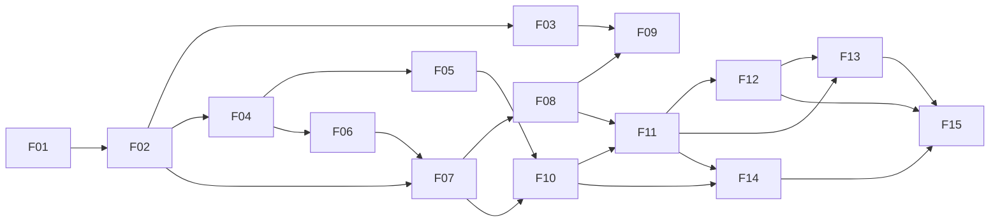

# MicroRAG — Roadmap de features

**Fecha:** 2026-10-25
**Estado:** ✅ aprobado por el usuario el 2026-10-25.
**Referencias:** `INVENTARIO.md` (pantallas, tokens, huecos G01–G42), `DECISIONS.md` (D-001…), `.specify/memory/constitution.md` (principios I–VIII).

Cada feature recorre el ciclo SDD de Spec Kit en su rama `NNN-nombre`:

1. `/speckit-specify`
2. `/speckit-clarify` — **parada de revisión**
3. `/speckit-plan`
4. `/speckit-tasks`
5. `/speckit-analyze` — **parada de revisión**
6. `/speckit-implement`

Skills complementarias:
- `/speckit-checklist`: listas de requisitos por dominio (a11y, privacidad, rendimiento).
- `/speckit-converge`: completa tareas pendientes si la implementación diverge.
- `/speckit-taskstoissues`: solo si se quiere pasar las tareas a issues de GitHub.

Al cerrar cada feature se entrega:
- el resumen;
- build, lint y tests;
- las diferencias frente al mockup;
- las cifras medidas;
- la actualización de esta tabla.

**Tipos:**
- **Producto**: UI final según el PNG.
- **Técnica**: sin UI de producto, con diagnóstico interno solo en debug y nunca UI de producto inventada.

**Estados:** ⬜ pendiente · 🟨 en curso (se indica la fase SDD) · ✅ cerrada · ⏸ bloqueada.

## Resumen

| ID | Feature | Tipo | Depende de | Estado |
|---|---|---|---|---|
| F01 | Fundaciones y design system | Producto (shell y DS) | — | ✅ cerrada (T059 TalkBack manual abierta) |
| F02 | Viabilidad on-device (fase 0) | Técnica | F01 | ✅ cerrada |
| F03 | Modelos y primer arranque | Producto | F01, F02 | ✅ cerrada (T071 TalkBack manual abierta) |
| F04 | Núcleo de datos RAG | Técnica | F02 | ✅ cerrada |
| F05 | Harness offline de evaluación | Técnica | F04 | ✅ cerrada |
| F06 | Importación y parsing | Producto | F04 | ✅ cerrada |
| F07 | Indexación | Producto | F02, F06 | 🟨 en curso (analyze; pendiente de revisión) |
| F08 | Biblioteca y detalle de documento | Producto | F07 | ⬜ |
| F09 | Inicio | Producto | F03, F07, F08 | ⬜ |
| F10 | Recuperación híbrida | Técnica | F05, F07 | ⬜ |
| F11 | Chat con fuentes | Producto | F08, F10 | ⬜ |
| F12 | Ajustes e Idiomas | Producto | F03, F11 | ⬜ |
| F13 | Historial de chats | Producto (UI propuesta) | F11, F12 | ⬜ |
| F14 | Rendimiento en dispositivo y decisión INT8 | Técnica | F10, F11 | ⬜ |
| F15 | Pulido y release | Producto | F01–F14 | ⬜ |

### Por qué este orden (D-005)

1. **F02 va antes que F03.** Que Gemma 4 E2B y EmbeddingGemma 2 rindan en el teléfono de referencia es el mayor riesgo. Se comprueba con `adb push` sin construir la descarga, y deja los ficheros, hashes y backends que F03 necesita.
2. **F05 se adelanta.** La dimensión, el tamaño de chunk y la variante de embedding definen el espacio vectorial, y cambiarlos más tarde obliga a reindexar. Se fijan en escritorio antes de indexar en el móvil. Los benchmarks en el dispositivo y la decisión de INT8 quedan en F14.
3. **F08 va antes que F11.** Una cita del chat abre el detalle del documento.
4. **F09 es una feature propia.** Inicio agrega el estado de modelos, biblioteca e indexación. Hasta F09, el destino `home` es un marcador del shell, solo en debug.

---

## F01 — Fundaciones y design system

- **Tipo:** Producto. Shell y design system; sin pantallas de producto finales.
- **Estado:** ✅ cerrada: implementada el 2026-10-25 en la rama `001-foundations-design-system` y aprobada por el usuario el mismo día. Informe de cierre en `specs/001-foundations-design-system/report.md`. Queda abierto el recorrido manual con TalkBack (T059).

**Objetivo.** Dejar una base compilable y verificable sobre la que montar el resto:
- configuración del proyecto;
- paquetes por capa (D-009);
- DI;
- navegación con las rutas de `01-navigation.md` y la barra inferior;
- design system completo con tokens, tipografía, iconos y componentes `Lisdata*`, con previews y un catálogo interno.

**Pantallas y mockups.**
- Los 10 PNG como referencia de tokens y componentes.
- Rutas y shell según `docs/disegn_app/docs/01-navigation.md`.
- Componentes según `03-components.md` e `INVENTARIO.md` §4.
- Tokens según `00-design-system.md` e `INVENTARIO.md` §2.

**Secciones del informe.** Configuración base (ABI) · Privacidad y copias de seguridad (`allowBackup=false`) · Memoria y ciclo de vida (dispatchers dedicados) · Estructura del proyecto (adaptada a un solo módulo).

**Dependencias.** Ninguna.

**Criterios de aceptación.**
1. `./gradlew assembleDebug lintDebug testDebugUnitTest` en verde.
2. Manifiesto y build:
   - `allowBackup="false"`;
   - `dataExtractionRules` excluye todo;
   - sin permiso `INTERNET`, que llega en F03;
   - minSdk acordado (≥ 26, D-006);
   - `abiFilters` = `arm64-v8a` (más `x86_64` en debug).
3. Koin arranca con un módulo por capa, y un test verifica el grafo de dependencias.
4. NavHost con las rutas `welcome`, `setup`, `home`, `chat/{conversationId?}`, `ingest`, `library`, `document/{documentId}`, `index`, `settings` y `languages`:
   - la barra inferior aparece solo en `home`, `chat`, `library` y `settings`;
   - Atrás no duplica pilas de pestañas (test de navegación);
   - la flecha Atrás de las pestañas sigue G08.
5. `LisdataTheme`:
   - tokens claro y oscuro de `INVENTARIO.md` §2 (G05, G06, G07 y G42 resueltos);
   - Google Sans estática;
   - `Typography` mapeada;
   - sin hex fuera de `core.designsystem` (comprobación automática);
   - un test unitario de contraste de los pares texto/fondo: ≥ 4,5:1, o 3:1 en texto grande.
6. Los iconos `ic_*` de `INVENTARIO.md` §2.6 están como vector drawables de Lucide, con la licencia ISC incluida.
7. Todos los componentes de `INVENTARIO.md` §4 tienen previews en claro, oscuro, texto largo, `fontScale` 2.0 y estado de error.
8. Catálogo de componentes interno navegable, solo en debug.
9. Hay dispatchers dedicados de un solo hilo para SQLite, LLM y embeddings, inyectables.
10. Strings en `strings.xml` (es), con `values-en` preparado.

**Riesgos.**
- Compatibilidad de AGP 9 (Kotlin integrado) con el plugin de Compose y Koin.
- Elegir entre Navigation Compose 2.10.2 y Navigation 3 (1.2.0, estable); se decide en el plan.
- Fuentes variables en Compose (se usan las estáticas) y peso del APK.
- Fidelidad de M3 frente al PNG (G18).

---

## F02 — Viabilidad on-device (fase 0)

- **Tipo:** Técnica. Pantalla de diagnóstico interna, solo en debug.
- **Estado:** ✅ cerrada: implementada el 2026-10-26 en la rama `002-ondevice-feasibility` y aprobada por el usuario el mismo día. Informe de cierre en `specs/002-ondevice-feasibility/report.md` y cifras en `benchmarks.md`. Decisiones D-023 (Gemma genérico en GPU), D-024 (consulta en CPU; GPU apta para la ingesta), D-025 (EmbeddingGemma 2 de 270M) y D-026 (G44: presupuesto de primer token ≤ 5 s con ≈ 2.000 tokens; constitución v1.1.0). Teléfono de referencia: Nothing Phone (1) (D-022).

**Objetivo.** Demostrar que Gemma 4 E2B y EmbeddingGemma 2 funcionan en el teléfono de referencia con LiteRT-LM 0.18.1, y medir:
- `initialize()` en frío de cada engine;
- embedding de consulta en CPU y GPU (p50/p95) para cada variante (270M, 440M y 740M);
- TTFT con un prompt de 2.000 tokens;
- prefill y decode en tok/s;
- RSS pico.

También se introduce `EngineCoordinator`, que garantiza que nunca haya dos engines en GPU a la vez.

**Pantallas y mockups.** Ninguna de producto; solo diagnóstico interno.

**Secciones del informe.** Resumen ejecutivo y Configuración base · Distribución de modelos (fase de desarrollo: `adb push`) · Embeddings con EmbeddingGemma 2 (Prefijos, Truncación y normalización, API, Backend) · Generación (Modelo y runtime) · Memoria y ciclo de vida · Plan del POC, fase 0 · Puntos a verificar al empezar (longitud máxima de entrada con `ModelInfo`, diferencias CPU/GPU).

**Dependencias.** F01.

**Criterios de aceptación.**
1. Los modelos se cargan desde el directorio privado tras `adb push`, con el procedimiento documentado en `quickstart.md`. El SHA-256 se verifica contra el `lfs.oid` de HF antes de `initialize()`.
2. El embedding devuelve 256D con norma L2 = 1 ± 1e-5 y usa los prefijos constantes. La longitud máxima de entrada leída del modelo queda registrada.
3. Se mide el TTFT con 2.000 tokens. El embedding de consulta en CPU queda por debajo de 150 ms p95 (criterio de salida de la fase 0 del informe). Si no se cumple, se documenta y se decide con el usuario.
4. Un test unitario con fakes demuestra que `EngineCoordinator` impide dos engines GPU simultáneos.
5. Las cifras se recogen en `specs/<feature>/benchmarks.md`, con dispositivo y versiones. DECISIONS registra:
   - fichero de Gemma genérico o `-gpu` (G35);
   - backend de embeddings;
   - variantes candidatas para F05 (G36).
6. El diagnóstico no existe en la build de release (verificado).

**Riesgos.**
- Rendimiento insuficiente en el dispositivo.
- Delegado GPU no disponible (`libOpenCL.so`; `uses-native-library` opcional).
- Presión de memoria.
- Diferencias entre la documentación y el AAR.
- No hay teléfono de referencia definido: se fija en el clarify.

---

## F03 — Modelos y primer arranque

- **Tipo:** Producto.
- **Estado:** ✅ cerrada: implementada y aprobada por el usuario el 2026-10-26. Informe de cierre en `specs/003-models-onboarding/report.md`.
  - **Decisiones:** D-027 (onboarding y descarga), D-028 (UIDT y WorkManager) y D-029 (español por defecto).
  - **Teléfono de referencia:** descarga real de 2,75 GB con pausa, muerte del proceso, modo avión y reinicio (+3,8 % de bytes); prueba de Gemma en GPU en ≈ 19 s; arranque en frío de 820 ms (mediana).
  - **Abierto:** recorrido manual con TalkBack (T071).

**Objetivo.** Onboarding real: Bienvenida → Preparación (3 pasos, G10) → Inicio.
- Descarga reanudable y verificada de los dos modelos (D-011).
- Comprobación de espacio y RAM.
- `ModelRepository` con `ModelState`.
- Persistencia del onboarding completado.

**Pantallas y mockups.**
- `01-bienvenida.png` y `screens/01-welcome.md`.
- `02-preparacion.png` y `screens/02-onboarding.md`.
- Propuestas G02, G09, G10, G30 y G31.

**Secciones del informe.** Distribución de modelos (descarga a `noBackupFilesDir/models/`, `Range`, `StatFs`, SHA-256; nunca cargar con el hash incorrecto) · Memoria y ciclo de vida (aviso con RAM < 7,5 GB) · Privacidad y copias de seguridad.

**Dependencias.** F01 y F02 (ficheros, tamaños y hashes decididos).

**Criterios de aceptación.**
1. El primer arranque muestra `welcome`. Con el onboarding completado, la app abre `home`.
2. La descarga va con WorkManager, en primer plano y con notificación:
   - se reanuda con `Range` tras matar la app o perder la red;
   - comprueba el espacio con `StatFs` antes de empezar;
   - el progreso son bytes reales.
3. El SHA-256 se verifica antes de marcar «Listo». Un hash incorrecto descarta el fichero y muestra Error o Incompatible. Un test garantiza que nunca aparece «Listo» sin verificación.
4. Aviso de RAM < 7,5 GB y confirmación del tamaño de descarga (G31).
5. «Continuar» solo se habilita con ambos modelos en «Listo» y el almacenamiento preparado. El usuario sabe en cada momento por qué no puede avanzar.
6. El permiso `INTERNET` lo usa solo el paquete de descarga, con una comprobación automática de que ningún otro paquete abre conexiones.
7. El onboarding se recupera tras cerrar la app en cualquier paso.
8. La UI es fiel a los PNG 01 y 02; los estados no maquetados siguen la propuesta aprobada.
9. Accesibilidad: el progreso tiene descripción verbal y los estados se entienden sin color.
10. Permiso de notificaciones (G30).

**Riesgos.**
- Descargas de 2–3 GB (datos móviles, duración).
- Cambios en el repositorio de HF, mitigados fijando el commit.
- Límites de los servicios en primer plano.
- Almacenamiento insuficiente.
- Importación por SAF como alternativa (G02), pendiente de decidir.

---

## F04 — Núcleo de datos RAG

- **Tipo:** Técnica. Sin UI; diagnóstico de la base opcional en debug.
- **Estado:** ✅ cerrada: implementada y aprobada por el usuario el 2026-10-26. Informe de cierre en `specs/004-rag-data-core/report.md`.
  - **Decisiones:** D-030 (clarify) y D-031 (extracción de nativas).
  - **Teléfono de referencia:** golden del normalizador al 100 % (367 pares); golden de embeddings con coseno mínimo 1,000000 en CPU y 0,992992 en GPU; búsqueda vectorial con 10k fragmentos con p95 de 23,1 ms; 0 violaciones del modo estricto.

**Objetivo.** Construir la capa de datos del RAG:
- `schema.sql` en `assets/`, ampliado según G27;
- `RagDatabase` sobre `BundledSQLiteDriver` + SQLite-Vector: `vector_init` en cada conexión, WAL y un solo escritor;
- validación de `rag_meta`;
- normalizador `SpanishText` v1;
- `normalizer_golden` y `embedding_golden`;
- generador Python mínimo en `offline/` con `litert-lm-api` (D-012).

**Pantallas y mockups.** Ninguna.

**Secciones del informe.** Esquema SQLite · Capa de datos en Kotlin · Búsqueda léxica en español · Motor vectorial · Test de compatibilidad offline ↔ móvil · Pipeline offline (normalizador) · Puntos a verificar (coordenadas Maven, `.so`, persistencia de `vector_init` y de la cuantización).

**Dependencias.** F02 (embedder Kotlin y variante provisional).

**Criterios de aceptación.**
1. Se verifica que `vector.so` carga en dispositivo ARM64 y en el emulador x86_64, con un test instrumentado (consulta de versión).
2. Tests instrumentados de:
   - inserción y `vector_full_scan`;
   - FTS5 con `bm25(chunks_fts, 3.0, 1.0)`;
   - triggers `ai`/`ad`/`au`;
   - `ON DELETE CASCADE`;
   - idempotencia de `INSERT OR IGNORE`.
3. Si `rag_meta` no coincide en modelo, dimensiones, prefijos o versión del normalizador, la búsqueda se bloquea (test).
4. `SpanishText` pasa los ejemplos del informe (`clientes→client`, `luces→luz`, `R-1234` intacto) y `normalizer_golden.jsonl` (≥ 300 pares) con coincidencia exacta en Kotlin (JVM e instrumentado) y en Python.
5. `embedding_golden.jsonl` (50 textos, de consulta y de documento) se genera offline. El test instrumentado exige coseno ≥ 0,99 por par.
6. Todo el acceso a la base va por el dispatcher de SQLite; StrictMode en debug sin violaciones en Main.
7. `schema_version` con la estrategia de migración documentada.

**Riesgos.**
- Carga de una extensión sin prefijo `lib` y `extractNativeLibs`.
- Entry point de `addExtension` sin confirmar.
- Diferencias numéricas entre CPU y GPU.
- Python en macOS con extensiones de SQLite (`pysqlite3`).
- Filtrado de excluidos (G28), que se resuelve en F10.

---

## F05 — Harness offline de evaluación

- **Tipo:** Técnica. Python, sin UI.
- **Estado:** ✅ cerrada: implementada y aprobada por el usuario el 2026-10-26. Informe de cierre en `specs/005-offline-eval-harness/report.md` y cifras en `offline/reports/eval-report.md`. Decisiones D-033 (revisión por el asistente), D-034 (parámetros), D-035 (respuestas correctas 78,4 % frente al 80 %, aceptado con E2B) y D-036 (entradas de embedding largas).

**Objetivo.** Fijar en escritorio los parámetros de recuperación antes de indexar en el móvil:
- ~~variante de EmbeddingGemma 2~~: resuelta en F02 (D-025: 270M; las tres variantes dan vectores de texto idénticos);
- dimensión (128, 256, 512 o 768);
- tamaño de chunk (250, 350 o 500 tokens);
- cabecera contextual sí o no;
- normalización FTS;
- bloques finales (4, 6 u 8, con o sin vecinos), dentro del presupuesto de primer token (≤ 5 s con ≈ 2.000 tokens de prompt, D-026);
- E2B frente a E4B en calidad de respuesta.

**Pantallas y mockups.** Ninguna.

**Secciones del informe.** Pipeline offline (Python) · Evaluación (conjunto de prueba, métricas y umbrales, ablaciones) · Embeddings (truncación: la menor dimensión que no pierda más de un 1 % de nDCG@10 frente a 768).

**Dependencias.** F04 (`schema.sql`, `normalizer.py`, golden).

**Criterios de aceptación.**
1. `offline/` es reproducible:
   - dependencias con versiones fijadas (`litert-lm-api==0.18.1`);
   - construye un índice de evaluación con el mismo `schema.sql`, prefijos, cabecera, truncado y normalizador que la app.
2. Conjunto de prueba sobre un **corpus público versionado** (G37, D-032):
   - ~300 preguntas;
   - ~50 sin respuesta;
   - ~40 de seguimiento;
   - al menos 100 revisadas a mano;
   - relevantes identificados por `(content_hash, ordinal)`.
3. Informe con las métricas del informe:
   - Recall@20 híbrido ≥ 0,90;
   - Recall@6 ≥ 0,80;
   - MRR híbrido ≥ el de vector y el de FTS por separado;
   - respuestas correctas ≥ 80 %;
   - negativa correcta ≥ 85 %;
   - citas correctas ≥ 90 %;
   - y todas las ablaciones.
4. Las decisiones (variante, dimensión, chunk y bloques) se registran en DECISIONS y se propagan a las constantes Kotlin.

**Riesgos.**
- No hay corpus representativo.
- Generar preguntas «con un modelo grande» puede implicar un servicio externo con documentos de desarrollo: se decide con el usuario en el clarify.
- `litert-lm-api` en macOS (alternativa: Linux o CI).
- Tiempo de embebido en CPU.

---

## F06 — Importación y parsing

- **Tipo:** Producto.
- **Estado:** ✅ cerrada: implementada y aprobada por el usuario el 2026-10-26 en la rama `006-import-parsing`. Decisiones D-037 (importación) y D-038 (diseño). Informe de cierre en `specs/006-import-parsing/report.md`. Queda abierto el recorrido manual con TalkBack (T072).

**Objetivo.** Importar y preparar los documentos:
- selección múltiple con SAF;
- copia a almacenamiento privado;
- SHA-256 con detección de duplicados (G22);
- validación de tipo, tamaño, cifrado y presencia de texto;
- registro del documento como `pending`;
- parsers:
  - PDF con texto (páginas y detección de PDF sin texto);
  - TXT;
  - Markdown (encabezados `#` como ruta);
- `Chunker` según el informe, con `ordinal`;
- cola de importación observable.

**Pantallas y mockups.** `05-ingesta.png` y `screens/05-ingestion.md`. Ajustes G14 y G15.

**Secciones del informe.** Parsing y chunking (Extracción, Estrategia, Chunker) · Esquema SQLite (`documents`) · Decisión previa: de dónde sale el corpus (documentos del usuario).

**Dependencias.** F04.

**Criterios de aceptación.**
1. `OpenMultipleDocuments` con los MIME de PDF, TXT y MD, sin permisos de almacenamiento amplios.
2. Copia privada y SHA-256. Un duplicado se detecta y se comunica.
3. Los errores son por archivo y no bloquean el resto: cifrado, corrupto, demasiado grande, no admitido, sin texto o sin espacio.
4. Tests de parsers con fixtures (PDF de texto multipágina, PDF escaneado, PDF cifrado, TXT y MD con encabezados): producen `RawBlock` con página y ruta de encabezados.
5. Tests del chunker:
   - no corta a mitad de frase, salvo en párrafos que superan el máximo;
   - un encabezado abre un chunk nuevo;
   - solape ≈15 %;
   - el máximo duro queda por debajo de la entrada máxima del modelo, contando prefijo y cabecera;
   - `ordinal` consecutivo.
6. La cola es observable y se recupera tras recrear la Activity y tras la muerte del proceso.
7. «Iniciar indexación» encola el trabajo y navega a `index`.
8. La UI es fiel al PNG 05 con los ajustes aprobados.

**Riesgos.**
- ~~`pdfbox-android` sin mantenimiento (G38) y peso en el APK.~~ Resuelto con D-037, que usa la API de PDF del sistema. Riesgo nuevo: los dispositivos con Android 12–14 sin la extensión S ≥ 13 no leen PDF.
- PDF complejos (tablas, columnas).
- Memoria con PDF grandes (200 páginas).

---

## F07 — Indexación

- **Tipo:** Producto.
- **Estado:** 🟨 en curso: spec y clarify aprobados el 2026-10-26 (`specs/007-indexing/`, D-039). Plan (D-040), tareas y analyze terminados; pendientes de revisión, incluidas las propuestas de UI P1–P11.

**Objetivo.** `IngestWorker` (`CoroutineWorker` en primer plano, reanudable):
- extrae, fragmenta, embebe y persiste en lotes transaccionales de 64;
- progreso real;
- pausa y reanudación con checkpoints;
- pausa térmica;
- publicación atómica: el documento pasa a `done` solo al final;
- pantalla de estado.

**Pantallas y mockups.** `08-indexacion.png` y `screens/08-indexing.md`. Ajustes G21 y G29.

**Secciones del informe.** Ingesta en el dispositivo (`IngestWorker`) · Memoria y ciclo de vida (solo el engine de embedding cargado) · Capa de datos en Kotlin (`insertChunks`, `quant_dirty`) · Embeddings (backend de ingesta) · Evaluación (ritmo en chunks/s).

**Dependencias.** F02 y F06.

**Criterios de aceptación.**
1. Un PDF de 200 páginas se importa sin intervención. Si se mata la app a mitad, al relanzar continúa sin duplicar (`INSERT OR IGNORE` por `(document_id, ordinal)`). Es el criterio de salida de la fase 3 del informe.
2. El progreso son fragmentos hechos sobre el total real, o indeterminado si no se conoce el total. Se restaura al reabrir.
3. Pausar y Reanudar son coherentes con el backend. Hay Reintentar por documento.
4. Con `THERMAL_STATUS_SEVERE` el trabajo se pausa y la UI lo explica.
5. Con almacenamiento insuficiente se detiene de forma segura y se avisa.
6. El LLM no está cargado durante la ingesta (`EngineCoordinator`).
7. Un documento solo es buscable cuando está en `done`.
8. Se mide y reporta el ritmo de embedding (chunks/s) en CPU y GPU en el teléfono de referencia.
9. La UI es fiel al PNG 08; los estados no maquetados siguen el MD.

**Riesgos.**
- Tipo y cuota del servicio en primer plano según `targetSdk` (verificar `dataSync` en Android 15+).
- Ritmo de embedding lento: puede requerir un límite por importación.
- Batería y temperatura.

---

## F08 — Biblioteca y detalle de documento

- **Tipo:** Producto.
- **Estado:** ⬜

**Objetivo.**
- Lista paginada con búsqueda por nombre y filtros Todos / Indexados / Pendientes (G16).
- Switch de inclusión persistido.
- Detalle con metadatos reales.
- Vista previa del fragmento, resaltado si se llega desde una cita.
- Acciones: Reindexar, Quitar del índice (G17) y Eliminar con confirmación.

**Pantallas y mockups.** `06-biblioteca.png` y `screens/06-library.md`; `07-detalle-documento.png` y `screens/07-document-detail.md`.

**Secciones del informe.** Esquema SQLite (`ON DELETE CASCADE`) · Capa de datos (`loadChunks`) · Ingesta en el dispositivo (reindexado) · Privacidad y copias de seguridad (borrado).

**Dependencias.** F07.

**Criterios de aceptación.**
1. La paginación es fluida con al menos 1.000 documentos (test con datos sintéticos) y no carga fragmentos.
2. Búsqueda y filtros se combinan, y su estado se conserva al volver del detalle y al rotar.
3. El switch está deshabilitado si el documento no está indexado. El cambio se persiste y solo afecta a recuperaciones futuras.
4. Eliminar abre un diálogo que explica las consecuencias. Borra la copia privada, los chunks, los vectores (FTS por trigger) y los metadatos, y marca INT8 como `dirty`.
5. Quitar del índice borra chunks y vectores y conserva el documento original, que sigue reindexable.
6. Reindexar mantiene el índice anterior hasta sustituirlo de forma segura.
7. Un documento inexistente muestra un aviso y vuelve a Biblioteca sin crash.
8. TalkBack anuncia el nombre, el estado y la inclusión.
9. Estados de vacío, sin resultados, carga (skeleton) y error con reintento.
10. La UI es fiel a los PNG 06 y 07.

**Riesgos.**
- El reindexado seguro necesita espacio temporal doble.
- Coste del borrado masivo en FTS.

---

## F09 — Inicio

- **Tipo:** Producto.
- **Estado:** ⬜

**Objetivo.** Pantalla de Inicio con:
- estado real de los modelos;
- agregados reales de la biblioteca;
- accesos rápidos funcionales;
- tarjeta de indexación en curso;
- estado vacío.

**Pantallas y mockups.** `03-home.png` y `screens/03-home.md`.

**Secciones del informe.** Ninguna directa; los agregados se obtienen a través de los repositorios.

**Dependencias.** F03, F07 y F08.

**Criterios de aceptación.**
1. El chip «IA local disponible» solo aparece con ambos modelos verificados. Si no, se muestra «Configuración pendiente» con CTA a `setup`.
2. Los contadores salen de `COUNT`/`SUM` en SQL y son reactivos, sin cargar listas completas.
3. Con la biblioteca vacía: «Tu biblioteca está vacía» y «Importar primer documento», sin estadísticas.
4. Con una indexación activa: tarjeta con el estado y acceso a `index`.
5. Se llega a «Nuevo chat» con una sola interacción.
6. Los accesos Importar, Documentos e Índice son funcionales. Idiomas queda enlazado al marcador de debug hasta F12.
7. Responsive y accesible con texto grande.
8. Si falla la carga del resumen, se mantienen los accesos y se ofrece un reintento local.

**Riesgos.** Bajos.

---

## F10 — Recuperación híbrida

- **Tipo:** Técnica. Diagnóstico de búsqueda interno, solo en debug.
- **Estado:** ⬜

**Objetivo.** `HybridRetriever`:
- embedding de consulta en CPU;
- vector top-50 + FTS top-50;
- RRF con k = 60;
- `ContextSelector`:
  - máximo 3 bloques por documento;
  - vecinos para los dos primeros;
  - presupuesto de ~2.200 tokens y 6 bloques;
  - orden por documento y ordinal;
  - fusión sin solape;
- regla de seguimiento;
- filtro de documentos excluidos o no indexados (G28);
- validación de `rag_meta`.

**Pantallas y mockups.** Ninguna de producto.

**Secciones del informe.** Recuperación y selección de contexto (Flujo, Preguntas de seguimiento, Selección de contexto) · Búsqueda léxica en español · Motor vectorial (latencia y criterio INT8) · Capa de datos en Kotlin.

**Dependencias.** F05 (parámetros) y F07 (datos reales).

**Criterios de aceptación.**
1. Tests unitarios de RRF, `ContextSelector` (límite por documento, presupuesto, vecinos, fusión y orden) e `isFollowUp`, con los casos del informe.
2. Los documentos excluidos o que no están en `done` nunca aparecen en los resultados (test instrumentado).
3. El diagnóstico en debug muestra, para cada pregunta, los bloques con sus puntuaciones y las latencias de embedding, vector, FTS y total.
4. Se miden las latencias p50/p95 con 10k chunks en el teléfono de referencia. Si el p95 vectorial supera 20 ms, se anota la decisión sobre INT8 (se implementa en F14).
5. El Recall@6 sobre una muestra de 50 preguntas del harness queda a ±5 pp del obtenido en escritorio.

**Riesgos.**
- Sobre-recuperación por las exclusiones.
- Diferencias entre el chunker de Kotlin y el de Python.
- FTS con consultas muy cortas.

---

## F11 — Chat con fuentes

- **Tipo:** Producto.
- **Estado:** ⬜

**Objetivo.** Conversación con documentos:
- estados `Retrieving`, `Generating`, `Completed`, `Cancelled` y `Failed`;
- streaming;
- `PromptBuilder` con idioma configurable (español por defecto, G25);
- detección de la negativa (G26);
- marcas `[n]` convertidas en citas reales (G11), y «Fuentes consultadas» solo con las fuentes citadas;
- copiar y cancelar (G12);
- persistencia local de los mensajes;
- ciclo de vida del engine;
- estados de bloqueo y de borde: modelo ausente, biblioteca vacía, cobertura parcial durante la indexación y fuente borrada.

**Pantallas y mockups.**
- `04-chat.png` y `screens/04-chat.md`.
- Cita → `07-detalle-documento.png` con el fragmento resaltado.
- Ajustes G11, G12, G13 y G39.

**Secciones del informe.** Generación (Modelo y runtime, Plantilla de prompt, una conversación de LiteRT-LM por pregunta) · Memoria y ciclo de vida · Recuperación (seguimiento) · Resumen ejecutivo (latencia dominada por el prefill).

**Dependencias.** F08 y F10.

**Criterios de aceptación.**
1. Buscar, generar, cancelar y error son estados distintos y se anuncian con TalkBack.
2. Ninguna cita sale sin un `documentId`/`chunkId` real. Un `[n]` fuera de rango se descarta (test).
3. Sin evidencia se muestra el mensaje del MD, sin citas.
4. Cita → detalle con el fragmento resaltado → Atrás vuelve al chat conservando el scroll.
5. Primer token ≤ 5 s de extremo a extremo con los bloques que fije F05 (prompt de ≈ 2.000 tokens como máximo) en el teléfono de referencia, medido y reportado (constitución IV, D-026). Si no se cumple, se ajustan bloques o tokens.
6. Cancelar detiene la generación y conserva el texto parcial, marcado como cancelado.
7. El teclado no tapa el compositor.
8. Prompts y respuestas no aparecen en los logs de release.
9. El engine se inicializa al abrir el chat y se libera en `onTrimMemory(UI_HIDDEN)`. Nunca hay dos engines en GPU.
10. La UI es fiel al PNG 04.

**Riesgos.**
- Calidad de E2B en español.
- Formato de citas inconsistente del modelo.
- TTFT.
- Interacción con la indexación en curso.

---

## F12 — Ajustes e Idiomas

- **Tipo:** Producto.
- **Estado:** ⬜

**Objetivo.**
- Ajustes con el estado real de los modelos y su detalle (G24).
- Preferencias (Idiomas, Índice y rendimiento).
- Privacidad: indicador informativo y Borrar historial.
- Idiomas: app en ES/EN con locales por app, e idioma de respuesta Automático/Español aplicado al prompt.

**Pantallas y mockups.** `09-configuracion.png` y `screens/09-settings.md`; `10-idiomas.png` y `screens/10-languages.md`. Ajustes G23, G24 y G25.

**Secciones del informe.** Distribución de modelos (estado y hash) · Privacidad y copias de seguridad · Generación (idioma de la plantilla de prompt).

**Dependencias.** F03 y F11.

**Criterios de aceptación.**
1. Las filas de modelo muestran su estado real, y el detalle incluye fichero, tamaño, SHA-256 abreviado, dimensiones y estado.
2. Cambiar el idioma de la app (ES/EN) no pierde el estado ni dispara una reindexación.
3. El idioma de respuesta (Automático/Español) se persiste y se aplica al prompt.
4. Borrar historial pide confirmación y elimina todas las conversaciones locales.
5. «Procesamiento 100% local» es informativo, no un switch.
6. Los ajustes persisten tras reiniciar (DataStore). Si falla la persistencia, se mantienen los valores previos.
7. Funciona la navegación a Idiomas y a Índice, y el acceso Idiomas de Inicio.
8. Traducciones EN revisadas de todos los strings.
9. La UI es fiel a los PNG 09 y 10.

**Riesgos.** Los locales por app con `ComponentActivity` requieren AppCompat o `LocaleManager` (API 33).

---

## F13 — Historial de chats

- **Tipo:** Producto, **sin mockup**. Requiere una propuesta de UI aprobada (D-007, G13).
- **Estado:** ⬜

**Objetivo.** Lista de conversaciones previas: abrir, continuar y borrar conversaciones locales.

**Pantallas y mockups.**
- Punto de entrada: el menú «⋯» de `04-chat.png` (G13).
- Pantalla de lista **propuesta** con componentes `Lisdata*` y aprobada antes de implementarse.

**Secciones del informe.** Generación (continuidad con la pregunta y la respuesta anteriores truncadas).

**Dependencias.** F11 y F12.

**Criterios de aceptación.**
1. Wireframe con componentes `Lisdata*` aprobado por el usuario antes de `/speckit-plan`.
2. Lista paginada por fecha, con el título derivado de la primera pregunta.
3. Abrir una conversación restaura sus mensajes y citas. Las citas a documentos borrados muestran «Fuente ya no disponible».
4. Borrar una conversación pide confirmación. «Borrar historial» de Ajustes vacía la lista.
5. «Nuevo chat» crea una conversación nueva.

**Riesgos.**
- Inventar UI, mitigado con la aprobación previa.
- Crecimiento del almacenamiento.

---

## F14 — Rendimiento en dispositivo y decisión INT8

- **Tipo:** Técnica. Diagnóstico y benchmark internos, solo en debug.
- **Estado:** ⬜

**Objetivo.** Completar la tabla de benchmarks del informe con corpus de 10k, 50k y 100k chunks:
- búsqueda F32 frente a INT8 (p50/p95/p99), FTS e híbrida;
- TTFT con 4, 6 y 8 bloques;
- prefill y decode;
- extremo a extremo;
- RSS, heap, tamaño del `.db`, batería y temperatura;
- sesión sostenida de 20–30 minutos;
- E2B frente a E4B;
- palancas para bajar el primer token por debajo de 5 s (D-026): decodificación especulativa y plantilla más corta.

Con esos datos se decide: INT8 sí o no, número de bloques y perfil de modelo.

**Pantallas y mockups.** Ninguna de producto.

**Secciones del informe.** Evaluación → Benchmarks en el dispositivo · Motor vectorial (criterio) · Capa de datos (`rebuildInt8`, preload, `quant_dirty`) · Plan del POC, fase 4.

**Dependencias.** F10 y F11.

**Dato de partida (F04):** con 10k fragmentos sintéticos, la búsqueda vectorial exacta da un p95 de 23,1 ms en el teléfono de referencia, ya por encima de los 20 ms del criterio 2 (`specs/004-rag-data-core/report.md` §4).

**Criterios de aceptación.**
1. `benchmarks.md` con cifras reales, dispositivo y versiones, que sustituyen los presupuestos del informe.
2. Si el p95 vectorial supera 20 ms: INT8 + preload implementado, con Recall@20 de INT8 frente a F32 ≥ 0,97. Si no, la decisión de quedarse en F32 queda documentada.
3. En la sesión sostenida se mantiene el primer token ≤ 5 s de extremo a extremo (constitución IV), o hay una decisión documentada.
4. Todas las decisiones se registran en DECISIONS.

**Riesgos.**
- Generar un corpus sintético de 100k que sea realista. Una base de benchmark construida offline y cargada con `adb` solo para medir es tooling de desarrollo y no se distribuye (D-002).
- *Throttling* térmico.

---

## F15 — Pulido y release

- **Tipo:** Producto.
- **Estado:** ⬜

**Objetivo.** Cerrar `docs/disegn_app/docs/04-qa-checklist.md`:
- estados vacío y error en todas las pantallas;
- accesibilidad: TalkBack, 48 dp, contraste y `fontScale` al 200 %;
- modo oscuro revisado;
- modo avión y test de bloqueo de red tras el onboarding;
- logs sin contenido privado;
- lecturas de disco en el hilo principal al arrancar, detectadas por StrictMode en F04 (`AppDirs`, DataStore y `DefaultModelDownloadController`);
- reglas de R8 para LiteRT-LM, SQLite-Vector y el parser de PDF;
- firma de release sin secretos en el repo;
- avisos de licencias OSS (Lucide ISC, Google Sans OFL y librerías);
- versión.

**Pantallas y mockups.** Las 10 pantallas, además del checklist QA.

**Secciones del informe.** Privacidad y copias de seguridad (test de bloqueo de red) · Distribución de modelos (evaluar Play Asset Delivery).

**Dependencias.** F01–F14.

**Criterios de aceptación.**
1. Checklist QA completo, con evidencias.
2. La build de release minificada funciona en el teléfono de referencia.
3. Un test instrumentado falla si hay tráfico de red después del onboarding.
4. La auditoría de accesibilidad no deja bloqueantes.
5. Las diferencias residuales frente a los mockups quedan documentadas.

**Riesgos.**
- R8 rompiendo JNI.
- Tamaño del APK.
- Política de distribución de los modelos en producción.

---

## Backlog (sin feature asignada)

| Elemento | Origen | Motivo |
|---|---|---|
| Exportar y restaurar biblioteca | Encargo · informe (Privacidad) | Sin mockup; decisión del usuario D-007 |
| OCR de PDF escaneados (ML Kit) | Encargo · informe (Parsing) | Sin mockup; el MD de ingesta lo deja fuera del MVP; D-007 |
| Importación de HTML (Jsoup) | Encargo · informe (Parsing) | Sin mockup; D-007 |
| DOCX | Informe (Parsing: «convertir offline en el POC») | Apache POI pesa mucho en Android |
| Protección de biblioteca (biometría/PIN) | `09-settings.md` | No está en el PNG (G23) |
| Gestionar almacenamiento (desglose) | `09-settings.md` | No está en el PNG (G23) |
| Preferencia «Solo mientras carga» y sección de recursos | `08-indexing.md`, `09-settings.md` | No está en los PNG (G21) |
| Información, licencias y diagnóstico en Ajustes | `09-settings.md` | No está en el PNG. Los avisos de licencias mínimos van en F15 (G23) |
| Português (app), English (respuestas) y detección de idioma | `10-languages.md` | No está en el PNG (G25) |
| Drag & drop en la ingesta | PNG 05 | No es nativo en móvil (G14) |
| Importar modelos por SAF | `02-onboarding.md` | Se decide en el clarify de F03 (G02) |
| FTS trigram como tercera lista | Informe (Búsqueda léxica) | Solo si la evaluación lo justifica (F05) |
| Play Asset Delivery y AICore | Informe (Distribución) · ficha de Gemma 4 | Se reevalúan antes de la release de producción |
