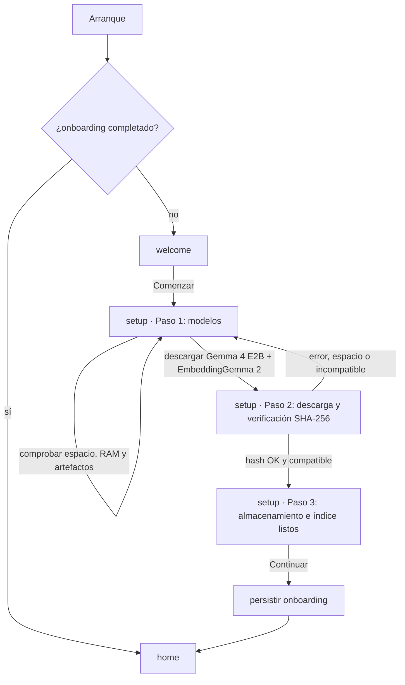
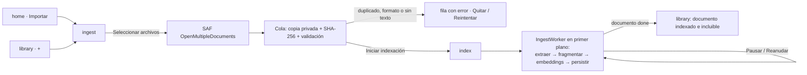
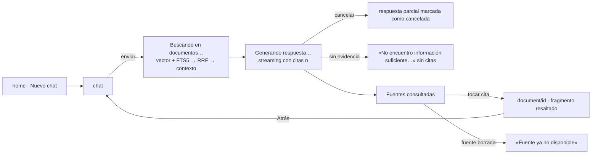
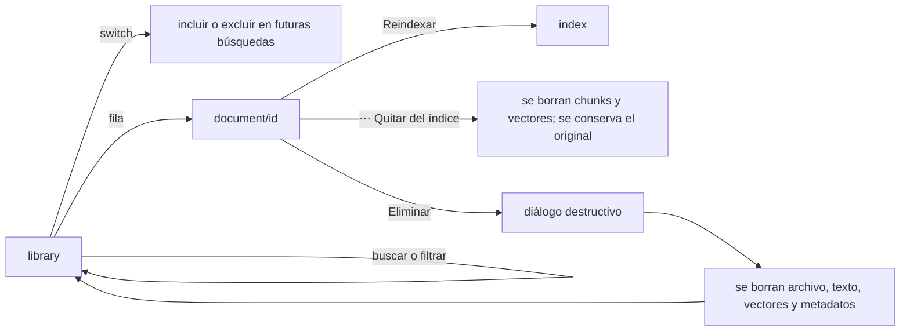
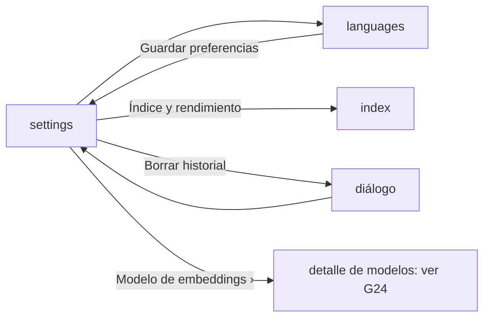

# MicroRAG — Inventario de descubrimiento

**Fecha:** 2026-10-25
**Estado:** ✅ aprobado por el usuario el 2026-10-25. Los huecos marcados 🟡 o ❓ se resuelven en el clarify de cada feature.

Este documento se elaboró sin escribir código de la app. Recoge lo encontrado en el design system, las pantallas, el informe técnico y la verificación externa de artefactos. Los datos de ejemplo de los mockups (nombres de documento, cifras, porcentajes) **no** son datos de producción.

> **Convenciones**
> - **PNG**: `docs/disegn_app/screens/LISDATA-10-PANTALLAS-PNG/*.png`, la fuente de verdad visual. Son capturas de 1170×2532 px a @3x, es decir, una anchura lógica de 390 dp.
> - **MD**: `docs/disegn_app/screens/*.md` y `docs/disegn_app/docs/*.md`.
> - **Informe**: `docs/RAG_Movil/informe-rag-movil-v2.md`.
> - Las medidas en dp salen del muestreo de píxeles de los PNG (px ÷ 3). Los radios están corregidos por antialiasing. La precisión es de ±1–2 dp en geometría y de ±1 sp en tipografía.

---

## 1. Fuentes y verificación

### 1.1 Rutas reales

Las rutas difieren de las del encargo inicial.

| Fuente | Ruta | Contenido |
|---|---|---|
| Design system | `docs/disegn_app/` | `README.md`, `CLAUDE.md`, `docs/00-design-system.md` … `04-qa-checklist.md`, `logoLISDATA.png` (raster de 2286×770, sin SVG) |
| Tipografías | `docs/disegn_app/Tipografias/` | Google Sans: variable (GRAD, opsz, wght) y estáticas de Regular a Bold con sus itálicas, en versión normal y 17pt. Licencia OFL (`OFL.txt`) |
| Iconos | `docs/disegn_app/iconos/LISDATA - Kit Iconos.pdf` | Catálogo de estilo de Magnific en 21 páginas (ver §2.6). **No se versiona** (`.gitignore`) |
| Pantallas | `docs/disegn_app/screens/01–10.md` y `screens/LISDATA-10-PANTALLAS-PNG/01–10.png` | 10 pantallas |
| Informe RAG | `docs/RAG_Movil/informe-rag-movil-v2.md` | Arquitectura RAG v2 (25-10-2026) |
| Spec Kit | `.specify/` y `.claude/skills/speckit-*` | v0.16.5. Comandos `/speckit-constitution`, `-specify`, `-clarify`, `-plan`, `-tasks`, `-analyze`, `-implement`, `-checklist`, `-converge` y `-taskstoissues`. No existe `.claude/commands/` |
| Scaffold Android | `app/`, `gradle/libs.versions.toml` | AGP 9.3.3, Kotlin 2.2.10, Compose BOM 2026.02.01, compileSdk 36.1, **minSdk 24**, targetSdk 36, `allowBackup="true"`, tema morado por defecto y `app_name` «MIcroRAG» |

### 1.2 Artefactos verificados

Verificados en fuentes primarias el 2026-10-25. En el `/speckit-plan` de cada feature se vuelven a comprobar.

| Pieza | Valor verificado | Nota frente al informe |
|---|---|---|
| LiteRT-LM Android | `com.google.ai.edge.litertlm:litertlm-android:0.18.1`. Está en **Google Maven**, no en Maven Central. minSdk 24, ABIs arm64-v8a y x86_64, Apache-2.0 | Coincide. `EmbeddingEngine.computeEmbedding`, `EmbeddingOptions(outputSize, normalize)` y `Conversation.sendMessageAsync` (Flow) existen |
| LiteRT-LM Python | **`litert-lm-api` 0.18.1** (`from litert_lm import EmbeddingEngine`) | ⚠️ El informe dice `litert-lm`, pero ese paquete es solo la CLI |
| Prefijos de EmbeddingGemma 2 | `task: search result \| text:` y `task: search query \| text:`, recortando espacios antes | Coinciden. No está confirmado el espacio final: se fija con el golden |
| Gemma 4 E2B | HF `litert-community/gemma-4-E2B-it-litert-lm`: `gemma-4-E2B-it.litertlm` (2.588.147.712 B) y `gemma-4-E2B-it-gpu.litertlm` (2.008.432.640 B). Público, sin gate, Apache-2.0, SHA-256 expuesto en `lfs.oid` | ⚠️ El fichero `-gpu` es más pequeño que el genérico; hay que decidir cuál en F02 |
| EmbeddingGemma 2 | Mismo origen. 740M multimodal (484.622.336 B), 440M texto+visión (387.710.976 B) y **270M solo texto** (`embeddinggemma-2-text-270m-litert-lm`, 164.626.432 B). Todos públicos y Apache-2.0 | El informe pedía comprobar si había un empaquetado solo de texto, y lo hay, pero es otro tamaño de modelo. La elección se hace por ablación en F05 |
| SQLite-Vector | `ai.sqlite:vector:1.1.2` en Maven Central, Apache-2.0. El `.so` se llama **`vector.so`** (sin prefijo `lib`). **AAR con minSdk 26** | `vector_init` se llama en cada conexión (como en el informe). La cuantización INT8 **se persiste en la BD** y el preload es solo de memoria |
| SQLite bundled | `androidx.sqlite:sqlite-bundled:2.7.1`, con `addExtension` y compilado con FTS5 | Coincide. Falta confirmar el entry point de `vector.so` |
| Resto (solo versión) | Koin 4.2.2 · WorkManager 2.12.0 · navigation-compose 2.10.2 · Navigation 3 estable 1.2.0 · DataStore 1.3.0 · jsoup 1.23.2 · ML Kit text-recognition 16.0.1 | ⚠️ **pdfbox-android 2.0.27.0 lleva sin publicarse desde enero de 2023** (riesgo en F06) |

Conclusiones:
- **minSdk ≥ 26 es obligatorio** por SQLite-Vector.
- La ficha de Gemma 4 recomienda AICore (Gemini Nano) para producción en dispositivos compatibles. Queda anotado como alternativa futura; no cambia el POC.

---

## 2. Design tokens

### 2.1 Color — tema claro

Fuente: `00-design-system.md` más el muestreo de los PNG. Los siete colores corporativos coinciden con el doc.

| Token (código) | Hex | Origen | Uso observado |
|---|---|---|---|
| `brandCyan` | `#02B0E2` | doc + PNG 08 (anillo) | Inicio de degradados y anillo de progreso |
| `brandBlue` | `#0070DD` | doc + PNG 02/04/06 | Iconos, chevrons, switch encendido, filtro seleccionado, cifra de fragmentos, etiqueta «LISDATA» |
| `navy900` | `#052A39` | doc + PNG 02/08 | Texto principal y botón oscuro «Pausar indexación» |
| `navy700` | `#0D3F51` | doc | Superficies oscuras secundarias (sin uso directo visible) |
| `blue800` | `#004994` | doc + PNG 02/04/06/07 | Texto de chips informativos, etiqueta de pestaña seleccionada y texto resaltado de cita |
| `ice200` | `#A8ECFD` | doc + PNG 01/03/08 | Eyebrow y texto de acento sobre fondo oscuro («Solo tuyo.», «COMPLETADO») |
| `ice100` | `#C9F6FF` | doc | Acentos suaves |
| `background` | `#F7FBFD` | PNG 02–10 | Fondo de pantalla |
| `surface` | `#FFFFFF` | PNG | Tarjetas, barra inferior y campos |
| `outline` | `#DDEBF0` | PNG (doc `#DCEAF0`) | Borde de tarjeta (1 dp), pista de la barra de pasos y separador sobre la barra inferior |
| `divider` | `#EEF5F7` | PNG 09 | Separadores dentro de una tarjeta |
| `surfaceInfo` | `#EAF8FD` | PNG 02/04/06/07 (doc `surfaceAlt`) | Chips informativos, filtros no seleccionados, chip «Página N» |
| `surfaceInfoAlt` | `#E7F5FC` | PNG 02/04/06/08 | Tile de icono, burbuja de usuario (`#E5F5FC`), tarjetas info y «Procesando ahora» (`#E9F7FC`). Se unifican en un token |
| `citationHighlight` | `#DDF4FF` | PNG 07 | Fondo de la frase citada en la vista previa |
| `neutralTile` | `#EFF4F6` | PNG 08 | Tile de etapa pendiente |
| `disabledContainer` | `#B6CBD4` | PNG 02 | Botón primario deshabilitado (texto blanco) |
| `textPrimary` | `#052A39` | = `navy900` | Títulos y cuerpo |
| `textSecondary` | `#658797` en el PNG / `#54798A` en el doc | ver G05 | Descripciones, eyebrows, etiquetas no seleccionadas y placeholder |
| `success` / `successContainer` | `#129D83` / `#E4F8F3` | PNG 02/03/07/08/09 | «Offline», «IA local disponible», «Indexado», «Completado», «Local», «Activo». Variantes de contenedor en el PNG: `#E3F8F1`, `#DDF8EE` y `#E2F8EF`, unificadas |
| `warning` / `warningContainer` | `#A46C19` / `#FFF4DF` | PNG 02 | «Por configurar» |
| `error` | `#DB5865` | PNG 07/09 | «Eliminar» y «Borrar historial» (icono y texto). El doc pide el rojo de M3: ver G06 |
| `onDarkTile` | `#294B5D` | PNG 07 | Tile de icono sobre hero oscuro |
| `onDarkChip` | `#164A5B` | PNG 01 | Chip sobre fondo oscuro |
| `onDarkTrack` | `#355E7B` | PNG 08 | Pista del anillo de progreso |

**Contraste WCAG.** Calculado sobre `background` o `surface`. Los colores que fallan en texto pequeño se tratan en G05/G06.

| Texto / fondo | Ratio | AA texto normal (4,5) |
|---|---|---|
| `#658797` / `#F7FBFD` | ≈3,7:1 | ❌ |
| `#54798A` / `#F7FBFD` | ≈4,5:1 | ✅ (justo) |
| `#A46C19` / `#FFF4DF` | ≈4,1:1 | ❌ |
| `#129D83` / `#E4F8F3` | ≈3,1:1 | ❌ (✅ si cuenta como texto grande en negrita) |
| `#DB5865` / `#FFFFFF` | ≈3,7:1 | ❌ |
| `#052A39` / `#F7FBFD` | >14:1 | ✅ |
| `#0070DD` / `#FFFFFF` | ≈4,8:1 | ✅ |
| Blanco / `gradientCta` | ≈2,6:1 (extremo cian) … ≈4,7:1 (extremo azul) | ⚠️ G42 (texto grande en negrita: umbral 3:1) |
| Blanco / `disabledContainer` | ≈1,7:1 | — (los controles deshabilitados están exentos en WCAG) |

### 2.2 Color — tema oscuro

No hay mockups oscuros. Esta tabla es **una propuesta, pendiente de aprobación (G07)**. Siguiendo el doc: se derivan roles semánticos, sin invertir los hex.

| Rol | Claro | Oscuro propuesto | Motivo |
|---|---|---|---|
| `background` | `#F7FBFD` | `#03161F` | Navy más profundo que `navy900` |
| `surface` | `#FFFFFF` | `#072634` | Cercano a `navy900` |
| `surfaceInfo` | `#EAF8FD` | `#0D3F51` (`navy700`) | Contenedor informativo |
| `outline` | `#DDEBF0` | `#1E4A5C` | Borde sutil |
| `primary` (acción) | `#0070DD` | `#02B0E2` (`brandCyan`) | `#0070DD` sobre navy da ≈3,1:1 ❌, `brandCyan` da ≈5,9:1 ✅ |
| `textPrimary` | `#052A39` | `#E6F4F9` | — |
| `textSecondary` | `#54798A` | `#9FBCC8` | — |
| `success` / contenedor | `#129D83` / `#E4F8F3` | `#4FD1B4` / `#0E3B36` | A validar en F01 |
| `warning` / contenedor | `#A46C19` / `#FFF4DF` | `#F2B759` / `#3D2E12` | A validar en F01 |
| `error` / contenedor | M3 / `#DB5865` | `#FF8A95` / `#4A1C22` | A validar en F01 |
| Hero y degradados | iguales | iguales | Ya son oscuros |

### 2.3 Degradados

| Token | Paradas | Dirección | Uso |
|---|---|---|---|
| `gradientCta` | `#02AEE2 → #0072DD` (≈ `brandCyan → brandBlue`) | Horizontal | Botones primarios («Comenzar», «Nuevo chat», «Seleccionar archivos», «Iniciar indexación», «Reindexar documento», «Guardar preferencias»), botón enviar, avatar «LISDATA» y tile sparkle |
| `gradientHero` | `#042B3C → #0155A4` (≈ `navy900 → blue800 → brandBlue`) | Diagonal ↘ | Hero de Inicio, Detalle, Indexación e Idiomas |
| `gradientWelcome` | `#052E45 → #023C6E → #01468A` | Vertical | Fondo de Bienvenida |
| `gradientStepProgress` | `#02ACE1 → #0072DD` | Horizontal | Relleno de la barra «PASO N DE 3» |
| `gradientLogo` | cyan → azul (logo oficial) | — | Solo el asset del logo, nunca recreado |

### 2.4 Tipografía

Familia: **Google Sans**, aportada en `Tipografias/` con licencia OFL. Sustituye a la propuesta «Roboto» de `00-design-system.md` (ver DECISIONS D-003). Pesos usados: Regular 400, Medium 500, SemiBold 600 y Bold 700. Las tallas se midieron sobre los PNG (±1 sp) y se mapean a `Typography` de M3.

| Estilo M3 | Talla / interlineado | Peso | Uso en el PNG |
|---|---|---|---|
| `displayMedium` | 34 / 40 sp | Bold | H1 de Bienvenida («Tu conocimiento. Solo tuyo.») |
| `headlineLarge` | 30 / 36 sp | Bold | H1 de pantalla («Tu IA, en tu móvil.», «Amplía tu biblioteca», «Tus documentos», «Ajustes», «Habla en tu idioma») |
| `headlineMedium` | 26 / 32 sp | Bold | Título de hero («Una respuesta. Todas tus fuentes.», nombre de documento en Detalle) y cifras de estadística («24», «12.400», «48», «860») |
| `titleLarge` | 22 / 28 sp | Bold | Título de la barra superior |
| `titleMedium` | 18 / 24 sp | SemiBold | Título de tarjeta o fila («Gemma 4», «Manual de procesos.pdf») |
| `bodyLarge` | 17 / 26 sp | Regular | Cuerpo de la respuesta del chat y texto de la burbuja (la burbuja va en SemiBold) |
| `bodyMedium` | 15 / 22 sp | Regular | Descripciones y subtítulos de fila («Modelo de respuestas», «2,4 MB · Listo para procesar») |
| `labelLarge` | 17 / 22 sp | Bold | Texto de botón primario |
| `labelMedium` | 13 / 18 sp | SemiBold | Chips de estado y filtros |
| `labelSmall` | 12 / 16 sp | Bold, mayúsculas, tracking 0,6 sp | Eyebrows y cabeceras de sección («INGESTA LOCAL», «FUENTES CONSULTADAS») |
| `navLabel` (custom) | 13 / 16 sp | Medium (SemiBold si está seleccionada) | Etiquetas de la barra inferior |
| `progressValue` (custom) | 40 / 44 sp | Bold | Porcentaje del anillo de Indexación |

Reglas: respetar el escalado del sistema, no fijar alturas de texto y probar con fuente al 200 %.

### 2.5 Espaciado, radios, bordes y elevación

| Token | Valor | Medido en PNG / doc |
|---|---|---|
| `spaceUnit` | 4 dp | doc |
| Escala | 4 · 8 · 12 · 16 · 20 · 24 · 32 dp | doc + PNG |
| `screenPaddingH` | 20 dp | PNG: 20 dp exactos en todas las pantallas |
| `gridGap` | 12 dp | PNG 03 (rejilla 2×2: tarjetas de 169 dp y hueco de 12 dp) |
| `listGap` | 12 dp | PNG 02/05/06 (separación entre tarjetas) |
| `cardPadding` | 16 dp | PNG (icono a ≈16 dp del borde) |
| `radiusCard` | 16 dp | PNG ≈16,3 dp corregido; doc 16 dp ✅ |
| `radiusHero` | 16 dp | PNG 08 ≈15,9 dp; PNG 10 ≈13–16 dp |
| `radiusButton` | 12 dp | PNG ≈10,7–12 dp; doc 12 dp ✅ |
| `radiusIconTile` | 12 dp | PNG ≈10–11 dp (tiles de 39–45 dp) |
| `radiusBubble` | 16 dp | PNG ≈14–16 dp (burbuja de usuario) |
| `radiusChip` | píldora (50 %) | PNG: chips de 27 dp de alto |
| `radiusSearch` | ≈24 dp | PNG 06 (campo de búsqueda de 48 dp) |
| `borderCard` | 1 dp `outline` | PNG: borde fino en todas las tarjetas blancas |
| `borderDashedDropZone` | 1,5 dp discontinuo, cyan claro | PNG 05 |
| Elevación | 0 dp (se usa borde, no sombra) | doc: «preferir borde suave sobre sombras» |
| `buttonHeight` | 52 dp (primario), 48 dp (secundario de Detalle) | PNG 01/02/05/08/10; PNG 07 |
| `searchHeight` | 48 dp | PNG 06 |
| `chipHeight` | 27 dp visual, **48 dp táctil** | PNG; doc exige 48 dp |
| `iconTileSize` | 44 dp (tarjeta), 40 dp (acción rápida) | PNG 02/05/06 ≈43–45; PNG 03 ≈39 |
| `iconSize` | 24 dp (20–24 según el doc) | PNG |
| `navIndicator` | ≈62×34 dp, radio ≈13 dp | PNG 03 (equivalente al indicador de M3) |
| `switch` | ≈42×24 dp en el PNG | Se usa M3 `Switch` tematizado (52×32): ver G18 |
| Barras del sistema | Edge-to-edge; status bar e insets del IME | doc |

### 2.6 Iconos

**Kit corporativo.** El PDF tiene 21 páginas: las 1–7 en azul, las 8–14 en oro y las 15–21 en violeta. Cada colorway incluye:
- «Basic Gradient»: 66 iconos de relleno degradado sobre fondo blanco, oscuro y degradado.
- «Rounded Lineal»: 54 iconos de trazo redondeado sobre fondo blanco y degradado.
- Instrucciones para localizarlos en Magnific.

Es un **catálogo de estilo**: no trae SVG exportados ni licencia, y le faltan la mayoría de los iconos de los mockups.

**Decisión del usuario (D-008):** usar **Lucide** (licencia ISC), cuyo trazo lineal redondeado coincide con los PNG. Los iconos se convierten a vector drawable (`res/drawable/ic_*.xml`), se tintan por token y no se mezclan estilos.

| Nombre en código | Lucide | Dónde aparece (PNG) |
|---|---|---|
| `ic_sparkle` | `sparkle` | 01 ilustración, 02 Gemma 4, 03 hero, 04 avatar, 09 modelo de respuestas |
| `ic_layers` | `layers` | 02 EmbeddingGemma 2, 09 modelo de embeddings |
| `ic_database` | `database` | 02 almacenamiento, 03 Índice local, 08 persistencia, 09 Índice y rendimiento |
| `ic_cpu` | `cpu` | 08 generación de embeddings |
| `ic_shield_check` | `shield-check` | 01 ilustración, 02 privacidad, 09 procesamiento 100 % local |
| `ic_home` | `house` | Barra inferior: Inicio |
| `ic_chat` | `message-square-text` | Barra inferior: Chat |
| `ic_folder` | `folder` | Barra inferior: Biblioteca; 03 Documentos |
| `ic_settings` | `sun` | Barra inferior: Ajustes; 03 cabecera. ⚠️ El PNG usa un sol, no un engranaje (G19) |
| `ic_chevron_left` | `chevron-left` | Atrás en todas las barras superiores |
| `ic_chevron_right` | `chevron-right` | Filas navegables y CTA con flecha |
| `ic_arrow_right` | `arrow-right` | 03 «Nuevo chat →» |
| `ic_more_horizontal` | `ellipsis` | 04 y 07, menú de la barra superior |
| `ic_upload` | `upload` | 03 Importar, 05 zona de importación |
| `ic_send` | `send` | 04 compositor |
| `ic_stop` | `square` | Cancelar generación (no maquetado: G12) |
| `ic_copy` | `copy` | 04 «Copiar respuesta» |
| `ic_trash` | `trash-2` | 07 Eliminar, 09 Borrar historial |
| `ic_plus` | `plus` | 06 importar |
| `ic_search` | `search` | 06 buscador |
| `ic_pause` / `ic_play` | `pause` / `play` | 08 Pausar / Reanudar |
| `ic_refresh` | `refresh-cw` | Reintentar y Reindexar (estados) |
| `ic_globe` | `globe` | 03 Idiomas, 09 Idiomas, 10 hero y búsqueda multilingüe |
| `ic_file_text` | `file-text` | 01, 04 fuentes, 05 cola, 06 filas, 07 hero, 08 procesando |
| `ic_info` | `info` | 06 tarjeta «Excluir…» |
| `ic_check` | `check` | 08 etapa completada, 10 «Guardar preferencias» |
| `ic_check_circle` | `circle-check` | Estado «Listo» (no maquetado) |
| `ic_warning` | `triangle-alert` | Estados de error y aviso (no maquetado) |
| `ic_close` | `x` | Borrar la búsqueda (añadido en la implementación de F01) |

**Logo.** Se usa `logoLISDATA.png` (oficial, raster) para el wordmark. Los PNG muestran «lisdata ›» en una sola tinta, lo que es una aproximación. CLAUDE.md prohíbe redibujar el logo: hace falta el SVG oficial (ver G20).

---

## 3. Inventario de pantallas

Abreviaturas de componentes: ver §4. «No maquetado» significa que el estado lo exige el MD pero no hay PNG; la propuesta está en §6.

### P01 — Bienvenida

- **Ruta:** `welcome`.
- **Ficheros:** PNG `01-bienvenida.png`; MD `screens/01-welcome.md`.
- **Feature:** F03.
- **Barra inferior:** no.
- **Propósito:** comunicar en segundos «IA privada sobre tus documentos, sin nube». Solo se muestra en el primer uso.
- **Contenido (PNG):**
  - fondo `gradientWelcome`;
  - logo arriba a la izquierda;
  - chip `onDarkChip` «● 100% EN TU DISPOSITIVO»;
  - ilustración decorativa: documento blanco con `ic_file_text`, tile degradado con `ic_sparkle`, tile blanco con `ic_shield_check`, órbitas concéntricas y puntos cyan;
  - H1 «Tu conocimiento.» en blanco y «Solo tuyo.» en `ice200`;
  - texto «Pregunta a tus documentos con IA.» y «Sin nube. Sin comprometer tu privacidad.»;
  - CTA a ancho completo «Comenzar ›» con `gradientCta`;
  - pie «PRIVADO · INTELIGENTE · LOCAL».
- **Componentes:** `LisdataStatusChip(onDark)`, `LisdataGradientButton`, logo e ilustración (asset decorativo).
- **Estados:**
  - estático;
  - en pantalla compacta, la ilustración cede espacio al texto y la CTA (MD).
- **Navegación:**
  - **entra** al arrancar si el onboarding no está completado;
  - **sale** con «Comenzar» → `setup`;
  - Atrás cierra la app.
- **Accesibilidad:**
  - el logo lleva descripción;
  - la ilustración no se anuncia;
  - CTA de 52 dp.
- **Diferencias con el MD:**
  - eyebrow «INTELIGENCIA DOCUMENTAL LOCAL» → chip «100% EN TU DISPOSITIVO»;
  - descripción distinta;
  - pie «Privado · Sin nube · En tu dispositivo» → «PRIVADO · INTELIGENTE · LOCAL».
  - Manda el PNG.

### P02 — Preparación inicial (onboarding)

- **Ruta:** `setup`.
- **Ficheros:** PNG `02-preparacion.png`; MD `screens/02-onboarding.md`.
- **Feature:** F03.
- **Barra inferior:** no.
- **Propósito:** llevar al usuario a un dispositivo realmente preparado (modelos verificados y almacenamiento listo) sin simular estados.
- **Contenido (PNG):**
  - `LisdataTopBar` «‹ Preparación inicial»;
  - chip `surfaceInfo` «PASO 1 DE 3» con barra de progreso (1/3, `gradientStepProgress` sobre `outline`);
  - H1 «Tu IA, en tu móvil.»;
  - texto «Configura los modelos para empezar a consultar documentos sin conexión.»;
  - `LisdataModelStatusRow` «Gemma 4 / Modelo de respuestas / [Por configurar]» con `ic_sparkle` y chevron;
  - `LisdataModelStatusRow` «EmbeddingGemma 2 / Búsqueda semántica / [Por configurar]» con `ic_layers` y chevron;
  - tarjeta «Almacenamiento local / Índice vectorial y archivos privados / [Offline]» con `ic_database`;
  - `LisdataInfoCard` «Tus documentos nunca salen de este dispositivo. / La instalación se verifica localmente.» con `ic_shield_check`;
  - CTA «Continuar», **deshabilitada** (`disabledContainer`).
- **Estados de modelo:**
  - el MD lista No instalado, Importando, Validando, Listo, Incompatible y Error;
  - el PNG solo muestra «Por configurar» (aviso);
  - mapeo propuesto en G09.
- **No maquetado:**
  - pasos 2 y 3;
  - descarga con progreso;
  - verificación;
  - falta de espacio;
  - RAM baja;
  - error con Reintentar;
  - modelos listos con la CTA habilitada.
- **Navegación:**
  - **entra** desde `welcome`, o al relanzar con el onboarding incompleto (el MD exige que sea recuperable);
  - **sale** a `home` solo con los requisitos cumplidos;
  - Atrás → `welcome`.
- **Diferencias con el MD:**
  - indicador «PRIMER USO» → «PASO 1 DE 3»;
  - H1 «Prepara tu espacio inteligente» → «Tu IA, en tu móvil.»;
  - CTA «Entrar en LISDATA» → «Continuar»;
  - la tarjeta de almacenamiento no está en el MD.

### P03 — Inicio

- **Ruta:** `home`.
- **Ficheros:** PNG `03-home.png`; MD `screens/03-home.md`.
- **Feature:** F09.
- **Barra inferior:** sí (Inicio).
- **Propósito:** acceso inmediato al chat y a la gestión documental.
- **Contenido (PNG):**
  - cabecera con el logo a la izquierda y `ic_settings` (sol) a la derecha;
  - chip de éxito «● IA local disponible»;
  - H1 «¿Qué quieres explorar hoy?»;
  - `LisdataHeroCard` con eyebrow «PREGUNTA A TU BIBLIOTECA», título «Una respuesta. Todas tus fuentes.», botón degradado «Nuevo chat →», órbitas decorativas y `ic_sparkle`;
  - rejilla 2×2 de `LisdataQuickActionTile`:
    - «Importar / Añadir archivos» (`ic_upload`);
    - «Documentos / Ver biblioteca» (`ic_folder`);
    - «Índice local / Estado del RAG» (`ic_database`);
    - «Idiomas / Preferencias» (`ic_globe`);
  - `LisdataStatCard` «TU BIBLIOTECA: 24 documentos · 12.400 fragmentos»;
  - `LisdataBottomBar`.
- **Estados según el MD (no maquetados, salvo el de contenido):**
  - biblioteca vacía: «Tu biblioteca está vacía» y CTA «Importar primer documento», sin estadísticas;
  - modelos no disponibles: chip «Configuración pendiente» con CTA;
  - indexación en curso: tarjeta pequeña con acceso a `index`;
  - error del resumen: se mantienen los accesos y se ofrece un reintento local.
- **Navegación:**
  - Nuevo chat → `chat` (conversación nueva);
  - los tiles llevan a `ingest`, `library`, `index` y `languages`;
  - el icono de cabecera → `settings`;
  - barra inferior.
- **Rendimiento:** los agregados se obtienen por SQL (`COUNT`), sin listas.
- **Diferencias con el MD:**
  - chip «IA disponible sin conexión» → «IA local disponible»;
  - saludo «¿Qué necesitas consultar hoy?» → «¿Qué quieres explorar hoy?»;
  - título del hero «Pregunta a tus documentos» → «Una respuesta. Todas tus fuentes.».
- **Implementada en F09** (`specs/009-home/contracts/home-ui.md`, D-046 y D-047). Sustituye al marcador y a los accesos provisionales de F06 y F07. Estados sin mockup, propuestas aprobadas:
  - P1 IA no lista: «Configuración pendiente» con «Completar configuración» → `setup`;
  - P2 comprobando: sin chip, con su hueco reservado;
  - P3 biblioteca vacía, dentro de la tarjeta del resumen, con «Importar primer documento»;
  - P4 resumen cargando (esqueleto) o con error, con «Reintentar» solo para el resumen;
  - P5 tarjeta de la tanda activa entre el héroe y los accesos, que abre `index`.

  Diferencias con el PNG, anotadas:
  - «documentos» va debajo de su cifra, como «fragmentos»;
  - las órbitas quedan dentro del héroe.

  Con la fuente al 150 % o más, los accesos van en una columna y las cifras se apilan.

### P04 — Chat con documentos

- **Ruta:** `chat/{conversationId?}`.
- **Ficheros:** PNG `04-chat.png`; MD `screens/04-chat.md`.
- **Feature:** F11 (el historial es F13).
- **Barra inferior:** sí (Chat).
- **Propósito:** preguntas en lenguaje natural con procedencia verificable.
- **Contenido (PNG):**
  - `LisdataTopBar` «‹ Chat con documentos» con `ic_more_horizontal`;
  - subtítulo «● Gemma 4 · Procesamiento local», con el punto en `success`;
  - burbuja de usuario a la derecha (`surfaceInfoAlt`, SemiBold);
  - tarjeta de respuesta con:
    - avatar degradado `ic_sparkle` y etiqueta «LISDATA» en `brandBlue`;
    - cuerpo con lista de viñetas en `brandBlue`;
    - separador;
    - «Copiar respuesta» (`ic_copy`);
    - chip «2 fuentes»;
  - cabecera «FUENTES CONSULTADAS»;
  - `LisdataSourceCitation` × 2: `ic_file_text`, «Manual de procesos.pdf», «Página 12 · Fragmento 86», chevron;
  - `LisdataChatComposer` «Pregunta a tus documentos...» con botón degradado `ic_send`.
- **Estados según el MD (no maquetados, salvo el de contenido):**
  - «Buscando en documentos...» (`Retrieving`);
  - «Generando respuesta...» con streaming;
  - cancelación;
  - biblioteca vacía: ilustración y CTA «Importar documentos»;
  - sin evidencia: «No encuentro información suficiente en tus documentos», sin citas;
  - modelo ausente: bloqueo con CTA a Ajustes o Preparación;
  - error de inferencia con «Reintentar»;
  - consulta durante la indexación: aviso de cobertura parcial;
  - fuente borrada: «Fuente ya no disponible»;
  - respuesta larga: scroll y copia.
- **Navegación:**
  - una cita lleva a `document/{documentId}` con el fragmento resaltado y se vuelve al chat;
  - Atrás del PNG: ver G08;
  - «⋯»: ver G13.
- **Diferencias:**
  - con el MD:
    - título «Consulta de documentos» → «Chat con documentos»;
    - subtítulo «Gemma 4 · RAG local» con indicador «Local» → «Gemma 4 · Procesamiento local»;
  - con el informe:
    - el informe convierte cada `[n]` en un chip dentro del texto;
    - el PNG solo muestra el chip «N fuentes» y la lista (G11).

### P05 — Importar documentos (ingesta)

- **Ruta:** `ingest`.
- **Ficheros:** PNG `05-ingesta.png`; MD `screens/05-ingestion.md`.
- **Feature:** F06.
- **Barra inferior:** no.
- **Propósito:** añadir archivos locales y explicar cómo pasan a estar disponibles.
- **Contenido (PNG):**
  - `LisdataTopBar` «‹ Importar documentos»;
  - eyebrow «INGESTA LOCAL»;
  - H1 «Amplía tu biblioteca»;
  - texto «Selecciona archivos de tu dispositivo.»;
  - `LisdataFilePickerCard`: borde discontinuo, tile `ic_upload`, «Arrastra o selecciona archivos», «Todo se procesa en tu móvil» y botón degradado «Seleccionar archivos»;
  - «Formatos: PDF · TXT · Markdown»;
  - cabecera «COLA DE IMPORTACIÓN» con chip «3 archivos»;
  - `LisdataQueueRow` × 3: tile `ic_file_text`, nombre, «2,4 MB · Listo para procesar», chevron;
  - CTA «Iniciar indexación ›».
- **Estados:**
  - según el MD: Seleccionado, En cola, Extrayendo, Fragmentando, Generando embeddings, Indexando, Listo, Error y Cancelado;
  - errores por archivo:
    - cifrado;
    - corrupto;
    - demasiado grande;
    - formato no admitido;
    - sin texto (PDF escaneado);
    - sin espacio;
    - URI revocado;
    - duplicado (G22);
  - acciones de error: Reintentar, Quitar de la cola y Ver detalle;
  - el PNG solo muestra «Listo para procesar»;
  - no maquetados: cola vacía y estados de error. Implementados en F06 con las propuestas aprobadas P1–P6 (`specs/006-import-parsing/contracts/ingest-ui.md`).
- **Navegación:**
  - **entra** desde el tile Importar de Inicio, el «+» de Biblioteca y la CTA de vacío de Inicio y Chat;
  - **sale** con «Iniciar indexación» → `index`;
  - el chevron de una fila: ver G15;
  - Atrás.
- **Diferencias con el MD:**
  - «Arrastra o selecciona archivos»: el MD prohíbe prometer drag & drop (G14);
  - no aparecen los chips de etapas «Extraer → Fragmentar → Embeddings → Indexar»;
  - CTA «Ver estado de indexación» → «Iniciar indexación».

### P06 — Biblioteca

- **Ruta:** `library`.
- **Ficheros:** PNG `06-biblioteca.png`; MD `screens/06-library.md`.
- **Feature:** F08.
- **Barra inferior:** sí (Biblioteca).
- **Propósito:** encontrar documentos, conocer su estado y controlar qué fuentes entran en el RAG.
- **Contenido (PNG):**
  - `LisdataTopBar` «‹ Biblioteca» con `ic_plus`;
  - H1 «Tus documentos»;
  - texto «Gestiona las fuentes de tu IA local.»;
  - `LisdataSearchField` «Buscar documentos...»;
  - `LisdataFilterChip`: «Todos» seleccionado (`brandBlue` con texto blanco), «Indexados» y «Pendientes» (`surfaceInfo` con texto `blue800`);
  - cabecera «24 DOCUMENTOS» con «Incluir en RAG»;
  - `LisdataDocumentRow` × 4: tile `ic_file_text`, nombre, «PDF · 860 fragmentos» y switch (encendido o apagado);
  - `LisdataInfoCard` «Excluir un archivo evita que se use en futuras respuestas. No lo elimina.» con `ic_info`, partida como en el PNG: la primera línea en negrita.
- **Implementada en F08** (`specs/008-library-detail/contracts/library-ui.md`). Estados sin mockup, propuestas aprobadas:
  - B1 carga: 4 filas *skeleton* bajo los filtros;
  - B2 vacío: «Aún no tienes documentos» con «Importar documentos», sin buscador ni filtros;
  - B3 sin resultados: «No hay coincidencias» con «Limpiar filtros»;
  - B4 error con «Reintentar», y biblioteca no disponible sin él;
  - B5 sin indexar: interruptor deshabilitado, «Se podrá incluir cuando esté indexado», y el chip «Error de indexación» si falló;
  - B6 excluido: interruptor apagado, «excluido de las respuestas» para TalkBack;
  - B7 reindexando: «· Reindexando» en `brandBlue`, o el chip «Reindexado fallido»;
  - B8 documento desaparecido: *snackbar* «Este documento ya no existe».
- **Estados según el MD (no maquetados, salvo el de contenido):**
  - vacío: «Aún no tienes documentos» con «Importar documentos»;
  - sin resultados: «No hay coincidencias» con «Limpiar filtros»;
  - cargando: skeleton de filas;
  - error con «Reintentar»;
  - documento con error: etiqueta «Error de indexación»;
  - documento excluido: estado visible y accesible;
  - documento sin indexar: switch deshabilitado.
- **Navegación:**
  - «+» → `ingest`;
  - una fila → `document/{id}`;
  - Atrás del PNG: ver G08.
- **Rendimiento:** paginación y SQL filtrado; nunca se cargan fragmentos.
- **Diferencias con el MD:**
  - eyebrow «BIBLIOTECA LOCAL» y título «Documentos» → «Tus documentos»;
  - descripción distinta;
  - el MD pide un chevron de detalle que el PNG no tiene;
  - filtro «Errores» opcional: no se añade (G16, resuelto).

### P07 — Detalle del documento

- **Ruta:** `document/{documentId}`, con un `chunkId` opcional cuando se llega desde una cita.
- **Ficheros:** PNG `07-detalle-documento.png`; MD `screens/07-document-detail.md`.
- **Feature:** F08.
- **Barra inferior:** no.
- **Propósito:** trazabilidad y mantenimiento seguro de un archivo.
- **Contenido (PNG):**
  - `LisdataTopBar` «‹ Detalle del documento» con `ic_more_horizontal`;
  - `LisdataHeroCard` oscuro: tile `onDarkTile` con `ic_file_text`, nombre en blanco y chip de éxito «● Indexado»;
  - rejilla 2×2 de `LisdataStatCard`: «PÁGINAS 48», «FRAGMENTOS 860» (en `brandBlue`), «TAMAÑO 2,4 MB» e «IMPORTADO 12 oct.»;
  - `LisdataSwitchRow` «Incluir en respuestas / Disponible para consultas RAG»;
  - cabecera «VISTA PREVIA DEL CONTENIDO»;
  - tarjeta con el chip «Página 12» y el texto con la frase citada resaltada (`citationHighlight`, texto `blue800` en negrita);
  - acciones: «Reindexar documento» (degradado) y «Eliminar» (borde con `ic_trash` y texto en `error`).
- **Implementada en F08** (`specs/008-library-detail/contracts/library-ui.md`). El chip del héroe es el de éxito normal, como en el PNG, no la variante para fondo oscuro. En el cierre (D-045), el subtítulo del interruptor pasa a depender del estado, y la vista previa sin cita se recorta a 3 líneas con «Ver más». Estados sin mockup, propuestas aprobadas:
  - D1 pendiente, D2 indexando (con enlace al Estado de indexación) y D3 error (con «Reintentar» si se puede);
  - D4 fuera del índice: «Reindexar documento» y «Eliminar», interruptor deshabilitado;
  - D5 reindexando, con la causa de la pausa de la tanda; D6 reindexado fallido, con «Reintentar» y «Descartar»;
  - D7 cita perdida; D8 diálogos de eliminar y de quitar del índice; D9 carga;
  - D10 falta la copia privada: solo «Eliminar»; D11 biblioteca no disponible.
- **Estados según el MD:** ninguno maquetado salvo el de contenido.
  - no encontrado o eliminado: aviso y vuelta a Biblioteca;
  - indexación en curso;
  - error;
  - sin vista previa;
  - permiso de archivo perdido (no aplica si se copia el archivo, ver G22);
  - nunca una página ficticia: si `page` es nulo, no hay chip.
- **Navegación:**
  - **entra** desde Biblioteca o desde una cita;
  - Atrás → origen;
  - «⋯»: ver G17.
- **Diferencias con el MD:**
  - hero «azul claro» en el MD frente a oscuro en el PNG;
  - el MD incluye «Tipo» y «Ubicación local» en la rejilla, que el PNG omite;
  - «Quitar del índice» no aparece: va en el menú «⋯» (G17, resuelto).

### P08 — Estado de indexación

- **Ruta:** `index`.
- **Ficheros:** PNG `08-indexacion.png`; MD `screens/08-indexing.md`.
- **Feature:** F07.
- **Barra inferior:** no.
- **Propósito:** visibilidad y control de trabajos largos (10k–100k fragmentos).
- **Contenido (PNG):**
  - `LisdataTopBar` «‹ Estado de indexación»;
  - `LisdataHeroCard` con eyebrow «PROCESAMIENTO LOCAL», `LisdataProgressRing` «68% COMPLETADO» (`brandCyan` sobre `onDarkTrack`) y «8.432 / 12.400 fragmentos»;
  - cabecera «ETAPAS DEL PROCESO»;
  - `LisdataStageRow` × 4:
    - «Extracción de texto / Completado» (`ic_check` en verde);
    - «Fragmentación / Completado»;
    - «Generación de embeddings / En curso» (`ic_cpu` en azul);
    - «Persistencia vectorial / Pendiente» (`ic_database` en gris);
  - `LisdataInfoCard` «Procesando ahora / Manual de procesos.pdf»;
  - botón oscuro (`navy900`) «Pausar indexación ⏸».
- **Estados según el MD (no maquetados, salvo el de contenido):**
  - sin tareas: «Todo actualizado»;
  - en curso;
  - pausado con causa y «Reanudar»;
  - error con el documento, la causa y «Reintentar»;
  - batería baja o temperatura elevada;
  - almacenamiento insuficiente;
  - total desconocido: «Procesando...» con barra indeterminada, sin porcentajes inventados.

  Implementados en F07 con las propuestas aprobadas P1–P12 (`specs/007-indexing/contracts/index-ui.md`), también la espera por el sistema, el modelo ausente y la biblioteca no disponible. La batería no pausa (D-039).
- **Navegación:**
  - **entra** desde el tile Índice de Inicio, la CTA de Ingesta y la fila «Índice y rendimiento» de Ajustes;
  - Atrás.
- **Diferencias con el MD:**
  - falta la sección de recursos («Solo mientras carga», espacio usado, estado térmico) (G21, fuera del MVP por D-039);
  - no se muestra el número de documentos en cola. F07 lo añade bajo «Procesando ahora» (P9).

### P09 — Configuración (Ajustes)

- **Ruta:** `settings`.
- **Ficheros:** PNG `09-configuracion.png`; MD `screens/09-settings.md`.
- **Feature:** F12.
- **Barra inferior:** sí (Ajustes).
- **Propósito:** preferencias técnicas y de privacidad.
- **Contenido (PNG):**
  - `LisdataTopBar` «‹ Configuración»;
  - H1 «Ajustes»;
  - texto «Personaliza tu experiencia local.»;
  - INTELIGENCIA ARTIFICIAL:
    - `LisdataSettingsRow` «Modelo de respuestas / Gemma 4» (`ic_sparkle`, chip de éxito «Local»);
    - «Modelo de embeddings / EmbeddingGemma 2» (`ic_layers`, chevron);
  - PREFERENCIAS:
    - «Idiomas / Español» (`ic_globe`, chevron);
    - «Índice y rendimiento / Almacenamiento y procesamiento» (`ic_database`, chevron);
  - PRIVACIDAD Y DATOS:
    - «Procesamiento 100% local / Sin enviar documentos a la nube» (`ic_shield_check` en verde, chip «Activo», solo informativo);
    - «Borrar historial de chat / Eliminar conversaciones locales» (`ic_trash` en `error`, chevron).
- **Estados según el MD (no maquetados):**
  - modelo ausente, importando, incompatible o listo;
  - falta de espacio;
  - error al leer preferencias: se mantienen los valores previos.
- **Navegación:**
  - Idiomas → `languages`;
  - Índice → `index`;
  - chevron de embeddings: ver G24;
  - Borrar historial → `LisdataConfirmationDialog`.
- **Diferencias con el MD:**
  - faltan «Protección de biblioteca», «Gestionar almacenamiento», «Preferencias de batería y procesamiento» e «Información» (versión, licencias, diagnóstico): ver G23 y el backlog;
  - el MD pide mostrar artefacto, versión, tamaño y dimensiones de los modelos, y el PNG solo muestra el nombre.

### P10 — Idiomas

- **Ruta:** `languages`.
- **Ficheros:** PNG `10-idiomas.png`; MD `screens/10-languages.md`.
- **Feature:** F12.
- **Barra inferior:** no.
- **Propósito:** separar el idioma de la interfaz, el de las respuestas y la consulta multilingüe.
- **Contenido (PNG):**
  - `LisdataTopBar` «‹ Idiomas»;
  - eyebrow «CONFIGURACIÓN LINGÜÍSTICA»;
  - H1 «Habla en tu idioma»;
  - `LisdataHeroCard` con tile `ic_globe` y «Tus documentos.» en blanco / «Tu idioma.» en `ice200`;
  - «IDIOMA DE LA APLICACIÓN»: `LisdataRadioRow` con Español (seleccionado) y English;
  - «IDIOMA DE LAS RESPUESTAS»: Automático «Detectar idioma de la pregunta» (seleccionado) y Español;
  - `LisdataInfoCard` «Búsqueda multilingüe / Consulta documentos en distintos idiomas desde el mismo chat.»;
  - CTA «Guardar preferencias ✓».
- **Estados según el MD (no maquetados):**
  - guardando;
  - guardado;
  - error de persistencia;
  - idioma de respuesta no compatible;
  - detección no disponible.
- **Navegación:** Atrás → `settings`.
- **Diferencias con el MD:**
  - H1 «Habla con tus documentos en tu idioma» → «Habla en tu idioma»;
  - el MD añade Português (app) y English (respuesta), además de la tarjeta «Detección del idioma» (G25).

---

## 4. Componentes reutilizables

Todos van en el paquete `core.designsystem`, son presentacionales (sin ViewModel) y llevan previews en claro, oscuro, texto largo, fuente grande y estado de error (`03-components.md`).

| Componente | Variantes / props | Pantallas | Base M3 |
|---|---|---|---|
| `LisdataTheme` | Claro y oscuro; tokens de color, tipografía, forma y espaciado; degradados como `Brush` | Todas | `MaterialTheme` |
| `LisdataTopBar` | Título, Atrás opcional, acción opcional (`ic_plus`, `ic_more_horizontal`), subtítulo opcional (Chat) | 02, 04–10 | `TopAppBar` |
| `LisdataBottomBar` | 4 destinos (Inicio, Chat, Biblioteca, Ajustes) con indicador | 03, 04, 06, 09 | `NavigationBar` |
| `LisdataGradientButton` | Primario degradado, deshabilitado, ocupado (spinner), con icono final | 01, 02, 03, 05, 07, 10 | `Button` con `Brush` |
| `LisdataDarkButton` | Botón `navy900` con icono | 08 | `Button` |
| `LisdataOutlinedButton` | Destructivo (`error`) y neutro | 07 | `OutlinedButton` |
| `LisdataCard` | Superficie blanca con borde de 1 dp y radio de 16 dp | Todas | `OutlinedCard` |
| `LisdataHeroCard` | `gradientHero` con eyebrow, título, contenido y decoración (órbitas). Variante compacta para el 08 (D-042) | 03, 07, 08, 10 | Custom sobre `Box` |
| `LisdataInfoCard` | Contenedor `surfaceInfoAlt` con icono, título y texto | 02, 06, 08, 10 | `Card` |
| `LisdataIconTile` | Claro (`surfaceInfoAlt` + `brandBlue`), sobre oscuro (`onDarkTile`), éxito, neutro y degradado | 02–08, 10 | Custom |
| `LisdataStatusChip` | `local`, `ready`, `processing`, `queued`, `paused`, `error`, `warning` («Por configurar») y `onDark`. Texto e icono o punto, nunca solo color | 01, 02, 03, 07, 09 | `AssistChip` / custom |
| `LisdataFilterChip` | Seleccionado o no, con área táctil de 48 dp | 06 | `FilterChip` |
| `LisdataCountChip` | «3 archivos», «2 fuentes» y «Página N» | 04, 05, 07 | Custom |
| `LisdataEyebrow` / `LisdataSectionHeader` | Mayúsculas con tracking y acción opcional a la derecha («Incluir en RAG») | 03–10 | `Text` |
| `LisdataStepIndicator` | «PASO N DE M» con barra de progreso | 02 | `LinearProgressIndicator` |
| `LisdataModelStatusRow` | Icono, nombre, propósito, chip de estado, progreso opcional y chevron o acción | 02, 09 | Custom |
| `LisdataQuickActionTile` | Icono, título y subtítulo; botón completo | 03 | `Card(onClick)` |
| `LisdataStatCard` | Etiqueta y valor (énfasis opcional en `brandBlue`) | 03, 07 | Custom |
| `LisdataDocumentRow` | Tile de tipo, nombre truncado, «TIPO · N fragmentos» o estado, switch (deshabilitado si no está indexado) y semántica agrupada | 06 | `ListItem` + `Switch` |
| `LisdataQueueRow` | Nombre, tamaño, estado o progreso y acción contextual | 05 | `ListItem` |
| `LisdataSourceCitation` | Documento, «Página N · Fragmento M» (página opcional), variante «Fuente ya no disponible» y chevron | 04 | `Card(onClick)` |
| `LisdataChatBubble` / `LisdataAnswerCard` | Usuario; asistente con avatar, cuerpo con markdown simple, copiar, chip de fuentes, estados de streaming, cancelación y error | 04 | Custom |
| `LisdataChatComposer` | Campo, enviar y detener (G12); se fija sobre el IME | 04 | `TextField` |
| `LisdataProgressRing` | Determinado (%) o indeterminado | 08 | `CircularProgressIndicator` |
| `LisdataStageRow` | Completado, en curso, pendiente o error. Variante compacta de 56 dp, como el 08 (D-042) | 08 | Custom |
| `LisdataSettingsRow` | Icono, título, subtítulo, y chip o chevron; variante destructiva | 09 | `ListItem` |
| `LisdataSwitchRow` | Título, subtítulo y switch con etiqueta accesible | 07 | `ListItem` + `Switch` |
| `LisdataRadioRow` | Título, subtítulo opcional y radio | 10 | `ListItem` + `RadioButton` |
| `LisdataSearchField` | Placeholder, limpiar y 48 dp | 06 | `TextField` |
| `LisdataFilePickerCard` | Zona discontinua con CTA SAF | 05 | Custom |
| `LisdataEmptyState` | Icono, título, texto y CTA opcional | 03, 04, 05, 06, 08 | Custom |
| `LisdataErrorState` | Mensaje y «Reintentar» | Todas | Custom |
| `LisdataSkeletonRow` | Carga de listas | 06, 05 | Custom |
| `LisdataConfirmationDialog` | Título, consecuencias, cancelar y botón destructivo | 07, 09 | `AlertDialog` |
| `LisdataModelMissingBlock` | Bloqueo contextual con CTA a Preparación o Ajustes | 04, 03 | `LisdataEmptyState` |
| `LisdataLogo` | Asset oficial (raster hasta tener el SVG) | 01, 03 | `Image` |

---

## 5. Flujos de usuario

### 5.1 Primer arranque

Los pasos 2 y 3 no están maquetados (propuesta G10). El cierre de la app en cualquier paso es recuperable: la descarga va con WorkManager y se reanuda con `Range`.

### 5.2 Importar e indexar

### 5.3 Chatear y abrir una cita

### 5.4 Gestionar la biblioteca

### 5.5 Ajustes e idiomas

---

## 6. Huecos y contradicciones

**Precedencias acordadas:**
- En UI manda el PNG.
- En arquitectura RAG manda el informe.
- Si no está claro qué aplica, se pregunta al usuario.

La columna **Estado** indica si está resuelto y por quién, o si sigue pendiente.

| ID | Tema | Fuente A | Fuente B | Precedencia | Propuesta | Estado |
|---|---|---|---|---|---|---|
| G01 | Textos de pantalla | PNG (p. ej. «Tu IA, en tu móvil.») | MD (p. ej. «Prepara tu espacio inteligente») | UI → PNG | Usar los textos del PNG en todas las pantallas. Los estados no maquetados usan los textos del MD | ✅ Resuelto (precedencia) |
| G02 | Origen de los modelos | `02-onboarding.md`: «no incorporar descargas de Internet; importar con SAF» | Prompt e informe: descarga verificada con SHA-256 a `noBackupFilesDir` | Arquitectura → informe; el prompt lo autoriza | Descargar desde HF `litert-community` fijando la URL al commit y validando el SHA-256 publicado. La importación SAF como alternativa se decide en el clarify de F03 | ✅ D-027: descarga + «Seleccionar archivo del dispositivo» |
| G03 | Alcance sin mockup | Prompt: historial, exportar/restaurar, OCR, HTML | PNG: no existen | Usuario | Solo entra el **historial de chats** (F13, con UI propuesta). Exportar/restaurar, OCR y HTML pasan al backlog. Formatos del MVP: PDF con texto, TXT y MD | ✅ Usuario (D-007) |
| G04 | Iconos | Kit Magnific (sin SVG ni licencia) / doc: Material Symbols | PNG: trazo tipo Lucide | Usuario | Lucide (ISC) como vector drawables | ✅ Usuario (D-008) |
| G05 | Contraste de `textSecondary` | PNG `#658797` (≈3,7:1) | Doc `#54798A` (≈4,5:1) y constitución WCAG AA | Accesibilidad (constitución) sobre fidelidad de tono | Usar `#54798A` para texto secundario. Visualmente es casi idéntico | ✅ Usuario (D-015) |
| G06 | Contraste de los semánticos | PNG: `#A46C19`, `#129D83` y `#DB5865` en texto pequeño | Doc: error = rojo de M3; WCAG AA | Constitución | Mantener los rellenos y contenedores del PNG y oscurecer solo el texto: aviso `#8A5A12` (5,4:1), éxito `#087A65` (4,8:1), error `#C23F4D` (5,1:1) o el `#B3261E` de M3 (6,5:1). Se valida en las previews de F01 | ✅ Usuario (D-015) |
| G07 | Modo oscuro | No hay mockups | Doc: «derivar roles» | — | Paleta de §2.2, revisada en las previews de F01 y auditada en F15 | ✅ Usuario (D-016) |
| G08 | Atrás en pestañas | PNG: Chat, Biblioteca y Configuración muestran «‹» | `01-navigation.md`: son destinos de la barra inferior | UI → PNG | Mantener la flecha. Navega a Inicio sin duplicar la pila de pestañas | ✅ Implementado en F01 (flecha → Inicio, `SystemBackTest`) |
| G09 | Estados de modelo | PNG: solo «Por configurar» | MD: No instalado / Importando / Validando / Listo / Incompatible / Error | UI → PNG + MD para lo no maquetado | Por configurar (Missing) · Descargando N % (progreso real) · Verificando (indeterminado) · Listo · Incompatible · Error con Reintentar · Sin espacio. Todos con `LisdataStatusChip` | ✅ Aprobado con la spec de F03 (FR-007, FR-009, FR-010) |
| G10 | Pasos 2 y 3 del onboarding | PNG: «PASO 1 DE 3», solo maquetado el 1 | MD: un único flujo | — | 1 = Modelos (el PNG); 2 = Descarga y verificación (mismo layout, filas con progreso y aviso de tamaño, ≈2,6 GB + embeddings); 3 = Almacenamiento listo (tarjeta de almacenamiento y CTA habilitada) | ✅ D-027: una sola pantalla; el paso refleja el estado real |
| G11 | Citas en la respuesta | Informe: cada `[n]` es un chip dentro del texto | PNG: chip «N fuentes» y lista «Fuentes consultadas», sin marcas en el texto | UI → PNG; trazabilidad → informe | Lista tal como en el PNG, y marcas `[n]` del texto como pequeños tokens tocables con el mismo estilo que `LisdataCountChip`. «Fragmento M» = `ordinal + 1` | 🟡 Pendiente |
| G12 | Cancelar generación | MD: «cancelar generación si procede» | PNG: solo enviar | UI → PNG; funcionalidad → MD | El botón enviar se convierte en detener (`ic_stop`) mientras se genera | ✅ Componente listo en F01 (`LisdataChatComposer` enviar → detener); uso en F11 |
| G13 | Menú «⋯» del chat | PNG: icono sin contenido | MD: no definido | — | «Nuevo chat», «Historial» (F13) y «Borrar conversación» | 🟡 Pendiente |
| G14 | Drag & drop | PNG: «Arrastra o selecciona archivos» | `03-components.md`: no prometer drag & drop si no se implementa | Doc (veracidad) | Texto «Selecciona archivos» sin «Arrastra». Alternativa: implementar el drop (Android lo soporta en tablets o ventanas múltiples), pero queda fuera del MVP | ✅ Implementado: F01 (`LisdataFilePickerCard` sin «Arrastra») y F06 (título «Selecciona archivos») |
| G15 | Fila de la cola de ingesta | PNG: chevron en cada fila | MD: «Ver detalle» en los errores | — | El chevron abre una hoja inferior con el estado, el error y las acciones (Quitar o Reintentar) | ✅ F06: `QueueItemSheet` sobre `LisdataBottomSheet` (propuesta P3); quitar un documento pide confirmación |
| G16 | Filtros de la biblioteca | PNG: Todos / Indexados / Pendientes | MD: «ampliar con Errores si es necesario» | UI → PNG | Sin filtro Errores. «Pendientes» incluye todo lo no indexado, también los errores (con su chip) | ✅ Resuelto en F08: sin filtro «Errores» |
| G17 | Acciones del detalle | PNG: «Reindexar» y «Eliminar», y «⋯» sin contenido | MD: también «Quitar del índice» | — | «⋯» → «Quitar del índice» (borra chunks y vectores y conserva el original, que queda reindexable) | ✅ Resuelto en F08: estado propio «Fuera del índice» (D-043), reindexable |
| G18 | Componentes frente a M3 | PNG: switch de ≈42×24 dp, chips de 27 dp | M3: switch de 52×32 dp; chips de 32 dp con área táctil de 48 | Constitución (M3 tematizado, 48 dp) | M3 tematizado con los tokens; sin réplicas a medida. Diferencia de tamaño aceptada | ✅ Usuario (D-018) |
| G19 | Icono de Ajustes | PNG: sol | Convención y kit: engranaje | UI → PNG | Sol (`ic_settings` = Lucide `sun`) con la etiqueta «Ajustes» | ✅ Implementado en F01 (`ic_settings` = Lucide `sun`) |
| G20 | Logo | PNG: «lisdata ›» en una tinta (aproximación) | Asset oficial `logoLISDATA.png` (degradado, raster); CLAUDE.md: no reconstruir | Doc (marca) | Usar el PNG oficial escalado y pedir el SVG oficial para la versión final | 🟡 F01 usa el PNG oficial; pendiente del SVG |
| G21 | Recursos en Indexación | MD: «Solo mientras carga», espacio usado y estado térmico | PNG: no existen | UI → PNG | MVP sin la sección. La pausa térmica (informe) se comunica en el hero como causa de la pausa. «Solo mientras carga» queda en el backlog | ✅ D-039: sin la sección en F07; la pausa térmica se explica como causa de la pausa; «Solo mientras carga» en el backlog |
| G22 | Persistencia de los importados | MD: «copiar o persistir permisos URI» | Informe: `documents.uri`, `content_hash UNIQUE` | Arquitectura → informe | **Copiar** a `noBackupFilesDir/documents/` (sin dependencia de un URI revocable). El duplicado (mismo SHA-256) se marca como «Ya está en tu biblioteca» | ✅ F06: copia en `documents/<sha256>.<ext>`, duplicado detectado antes de renombrar (D-038) |
| G23 | Ajustes ausentes | MD: Protección de biblioteca, Gestionar almacenamiento, Batería e Información/licencias | PNG: no existen | UI → PNG | Al backlog. Las licencias OSS (Lucide, Google Sans y librerías) se exponen como mínimo antes de la release (F15) | 🟡 Pendiente |
| G24 | Detalle de modelo | PNG 09: chevron en «Modelo de embeddings» (y chip «Local» en el de respuestas) | MD: artefacto, versión, tamaño, dimensiones y estado | — | El chevron abre una hoja con los datos reales (fichero, tamaño, SHA-256 abreviado, dimensiones 256D y estado) y la acción revalidar o volver a descargar | 🟡 Pendiente |
| G25 | Idiomas | PNG: app ES/EN; respuesta Automático/Español | MD: + Português (app), + English (respuesta) y tarjeta de detección. Informe: prompt fijo en español | UI → PNG; prompt → informe | Opciones del PNG. «Automático» se resuelve con una instrucción al LLM («responde en el idioma de la pregunta»), sin detector. El FTS sigue siendo español (normalizador v1) y la búsqueda multilingüe depende del vector | 🟡 Pendiente · Base del idioma de la app hecha en F03 (D-029: español por defecto, inglés elegible por app); el selector y el idioma de respuesta siguen en F12 |
| G26 | Texto de negativa | Informe: «No encuentro esa información en los documentos disponibles.» (frase exacta en el prompt) | MD Chat: «No encuentro información suficiente en tus documentos» | Prompt → informe; UI → MD | El LLM emite la frase del informe como centinela; la UI la detecta y muestra el texto del MD localizado, sin citas | 🟡 Pendiente |
| G27 | Esquema frente a UI | Informe: `documents` sin inclusión, tamaño, páginas ni ruta local; estados `pending…done/error` | UI: switch de inclusión, tamaño, páginas, «Pausado» y «Cancelado» | Informe (base) + UI | Ampliar `schema.sql`: `included INTEGER`, `size_bytes`, `page_count`, `local_path` y estados `paused`/`cancelled`. Mantener `source` (siempre `'user'`) por compatibilidad | ✅ D-030 (F04) |
| G28 | Exclusión en la búsqueda vectorial | UI: excluir documentos | Informe: `vector_full_scan` top-k sobre toda la tabla | Informe | Sobre-recuperar (k × factor) y filtrar por `included = 1 AND status = 'done'`, o usar el filtro de SQLite-Vector si lo admite (se verifica en F10) | ✅ D-040: resuelto en F07 con top-(*k* + *m*) y el filtro `status = 'done' AND included = 1` en las dos búsquedas (*m* = fragmentos guardados no buscables); F10 hereda las búsquedas filtradas, y la carga de candidatos y vecinos de la recuperación aplica el mismo filtro (`searchableOnly`, research R7 de F10) |
| G29 | Etapas frente a lotes | PNG 08: 4 etapas secuenciales | Informe: embeddings y escritura intercalados por lotes de 64 | — | «Persistencia vectorial» = cierre del documento (`status=done`, optimize FTS y rebuild INT8 si aplica). Durante los lotes se muestra «Generación de embeddings: en curso» | ✅ D-040: «Persistencia vectorial» = cierre del documento (`status = done`), sin optimize de FTS; INT8 aplazado a F14 (D-030) |
| G30 | Permiso de notificaciones | Informe: worker en primer plano (requiere notificación) | PNG/MD: no tratan permisos | — | Pedir `POST_NOTIFICATIONS` (API 33+) con una explicación justo antes de la primera descarga o indexación. Si se deniega, la tarea sigue y la UI lo advierte | ✅ Aprobado con la spec de F03 (FR-007, FR-009, FR-010) |
| G31 | RAM y tamaño de descarga | Informe: aviso con < 7,5 GB de RAM; descarga ≈2–2,6 GB + embeddings | PNG: sin UI | — | `LisdataInfoCard` de aviso en el paso 1 o 2 y confirmación del tamaño antes de descargar | ✅ Aprobado con la spec de F03 (FR-007, FR-009, FR-010) |
| G32 | Marca y nombre | Doc y PNG: «LISDATA» (avatar, CTA «Entrar en LISDATA») | Proyecto: «MicroRAG» (`app_name` «MIcroRAG») | — | Etiqueta del launcher y marca en UI: **pregunta al usuario** | ✅ Usuario (D-014): «MicroRAG» |
| G33 | minSdk | Scaffold: 24 | SQLite-Vector: 26; ARM64 con ≥ 8 GB; tipos de servicio en primer plano | Técnica | minSdk **31** (Android 12). Mínimo absoluto 26 | ✅ Usuario (D-017): API 31 |
| G34 | Paquete Python | Informe: `litert-lm` | PyPI: `litert-lm-api` contiene el `EmbeddingEngine` | Verificación | Usar `litert-lm-api==0.18.1` en `offline/` | ✅ Verificado |
| G35 | Fichero de Gemma 4 | Informe: «≈2,6 GB» | HF: genérico 2,59 GB / `-gpu` 2,01 GB | Medición | Elegir en F02 según el backend real (GPU) y lo que se mida | ✅ D-023: genérico en GPU; el `-gpu` da texto incoherente con fp16 en la Adreno 642L |
| G36 | Variante de EmbeddingGemma 2 | Informe: 440M si no hay solo texto | HF: existe la 270M solo texto (165 MB) | Evaluación | Medir las tres en F02 (latencia y RAM) y elegir por nDCG en F05 | ✅ D-025: 270M; las tres dan vectores de texto idénticos (coseno 1,0) |
| G37 | Corpus de evaluación | Informe: ~300 chunks, preguntas, negativas y seguimientos | Repo: no hay documentos | — | El usuario aporta documentos representativos en español (se pide en el clarify de F05) | ✅ D-032: corpus público en español elegido en F05 y versionado con sus licencias |
| G38 | Mantenimiento de pdfbox-android | Informe: PdfBox-Android | Maven: última versión de enero de 2023 | Riesgo | Evaluar en F06 frente a alternativas mantenidas (p. ej. la extracción de texto de `PdfRenderer`/`androidx.pdf` en API recientes, a verificar) | ✅ D-037: API de PDF del sistema (`PdfRenderer` en API 35+ y `PdfRendererPreV` con la extensión S ≥ 13), sin pdfbox |
| G39 | Barra inferior con teclado | MD: «compositor fijo sobre teclado y barra inferior» | Android: el IME tapa la barra | — | Ocultar la barra inferior mientras el IME está visible y anclar el compositor a los insets del IME | ✅ Implementado en F01 (`shouldShowBottomBar`, N6) |
| G40 | Cromo iOS en los PNG | Status bar «9:41» e indicador de inicio de iOS | Android | — | Se ignora; se usa edge-to-edge con insets de Android | ✅ |
| G41 | Datos de ejemplo | PNG: 24 docs, 12.400 fragmentos, 68 %… | README/CLAUDE.md: nunca en producción | Doc | Solo en previews y fakes de test | ✅ |
| G42 | Contraste de las CTA con degradado | PNG: texto blanco sobre `#02AEE2 → #0072DD` | WCAG: 3:1 para texto grande en negrita (las etiquetas son de 17 sp Bold) | Constitución | Mantener el degradado y comprobar el contraste del tramo central bajo la etiqueta. Si no llega a 3:1, desplazar la parada cian (p. ej. empezar en `#0096D6`) | ✅ Usuario (D-015) |
| G43 | Icono del lanzador | Ningún asset de icono de app (solo el logotipo horizontal) | CLAUDE.md: no reconstruir la marca a mano | Doc (marca) | Mantener el icono del scaffold hasta recibir el icono oficial (adaptativo, primer plano y fondo) | ✅ Resuelto: icono adaptativo aportado por el usuario (Image Asset Studio, `ic_launcher-playstore.png`) |
| G44 | Presupuesto de TTFT | Constitución IV: primer token ≤ 3 s con 6 bloques | F02: 4,53 s con 1.986 tokens en el Nothing Phone (1) | Medición frente a constitución | Opciones en DECISIONS («Pendientes»): reducir el contexto, enmendar el presupuesto con la cifra medida o evaluar palancas en F14 | ✅ D-026: presupuesto ≤ 5 s de extremo a extremo con ≈ 2.000 tokens (constitución v1.1.0); F05 fija los bloques y F14 evalúa palancas |
